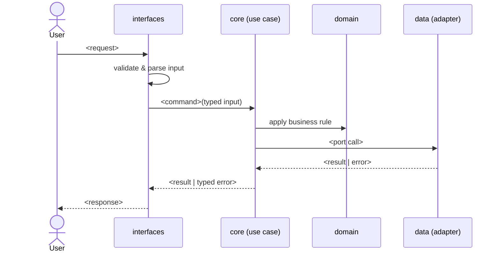

# SPEC-NNN: <Title>

<!--
How to use: create new specs with .ai/skills/new-spec, not by hand.
Replace every <placeholder>. Delete guidance comments before requesting approval.
An Approved spec must contain no TBD/TODO (.ai/scripts/validate-specs.sh enforces this).
-->

## Metadata

| Field | Value |
|---|---|
| ID | SPEC-NNN |
| Title | <Short noun phrase> |
| Status | Draft |
| Version | 0.1.0 |
| Author | <name / handle> |
| Owner | <who approves changes> |
| Dependencies | <SPEC-IDs, comma-separated, or `none`> |
| Created | YYYY-MM-DD |
| Last Updated | YYYY-MM-DD |

> Status lifecycle: `Draft → Approved → Deprecated`. Only `Approved` specs may be implemented. Only humans change Status.
> Version (semver): MAJOR = breaking §3 contract · MINOR = additive behavior · PATCH = clarification.

---

## 1. Problem Statement & Motivation

### 1.1 Problem
<!-- Who has the problem, what hurts today, and the evidence. 3–6 sentences. No solutions here. -->

### 1.2 Goals
<!-- Measurable outcomes. Each one becomes one or more ACs in §5. -->
- G1: <outcome + how we know>

### 1.3 Non-Goals
<!-- What this spec explicitly does NOT do. Prevents scope creep. -->
- NG1: <excluded behavior>

### 1.4 Open Questions
<!-- Must be empty (all resolved) before Status can become Approved. -->
| # | Question | Owner | Resolution |
|---|---|---|---|
| Q1 | <question> | <who> | <answer + date, or "open"> |

### 1.5 Assumptions
<!-- Things believed true but not verified. Each assumption is a risk; say what breaks if it's false. -->
- A1: <assumption> — if false: <impact>

---

## 2. Architectural Boundaries & Data Flow

### 2.1 Module Placement
| Layer | Path(s) owned by this spec | Responsibility |
|---|---|---|
| domain | `src/domain/<module>/` | <entities, rules> |
| core | `src/core/<module>/` | <use cases, ports> |
| data | `src/data/<module>/` | <adapters> |
| interfaces | `src/interfaces/<module>/` | <entrypoints> |

### 2.2 Data Flow


### 2.3 External Dependencies
| Dependency | Purpose | Failure mode | Timeout |
|---|---|---|---|
| <service/lib> | <why> | <what happens when it's down> | <ms> |

### 2.4 Decisions
<!-- Every hard-to-reverse choice. Rule 00 bans unrecorded architectural decisions. -->
| # | Decision | Alternatives considered | Rationale |
|---|---|---|---|
| D1 | <decision> | <options> | <why this one> |

---

## 3. Data Schemas & API Contracts

> Types in this section are **normative**. Implementations match names, types, optionality, and enums exactly.

### 3.1 Entities & Value Objects
```ts
// Language-neutral typed notation. `?` = optional; no implicit nulls.
type <EntityId> = string            // format: <uuid v7 | ulid | …>

interface <Entity> {
  id: <EntityId>
  <field>: <type>                   // constraints: <min/max/regex/enum>
  createdAt: Timestamp              // UTC, ISO-8601
}
```

### 3.2 Operations / API
| Operation | Input | Output | Errors (§4.2 codes) | Auth | Idempotent |
|---|---|---|---|---|---|
| `<verb><Noun>` | `<InputType>` | `<OutputType>` | `E_<CODE>` | <role/scope> | yes / no (why) |

<!-- For HTTP, also give: method, path, status codes, headers. For events: topic, payload schema, ordering guarantee. -->

### 3.3 Persistence
<!-- Tables/collections, keys, indexes, uniqueness constraints, retention. Write "none" if stateless. -->

### 3.4 Compatibility & Migration
<!-- Who consumes these contracts? What breaks if they change? Migration plan for existing data. -->

---

## 4. Error Modes, Invariants & Edge Cases

### 4.1 Invariants
<!-- Statements that must ALWAYS hold. Each one needs at least one AC. -->
| ID | Invariant |
|---|---|
| INV-01 | <e.g. a <Entity> never has more than N <things>> |

### 4.2 Error Modes
| Code | Trigger | Caller receives | Retryable | Side effects / state after |
|---|---|---|---|---|
| `E_VALIDATION` | input fails §3 constraints | <representation> | no | none |
| `E_NOT_FOUND` | <…> | <…> | no | none |
| `E_CONFLICT` | <…> | <…> | no | none |
| `E_UPSTREAM_UNAVAILABLE` | <dependency> timeout/5xx | <…> | yes (backoff) | <rolled back?> |

### 4.3 Edge Cases
<!-- Check at least: empty, one, many, max size, duplicate, concurrent writes, partial failure,
     retry after timeout, clock skew, unicode/locale, missing/expired/wrong-tenant auth,
     deletion while in use, out-of-order events, version skew between clients. -->
| ID | Scenario | Expected behavior |
|---|---|---|
| EC-01 | <scenario> | <behavior> |

### 4.4 Security & Privacy
- Authn/Authz: <who can do what>
- Data classification: <PII? retention? encryption at rest/in transit?>
- Abuse cases: <rate limits, enumeration, injection surface>

### 4.5 Non-Functional Requirements
<!-- Only the ones that matter, each with a number: latency p95, throughput, availability, cost. -->

---

## 5. Verification Matrix

> Every Goal (§1.2), Invariant (§4.1), Error code (§4.2), and Edge case (§4.3) is covered by at least one AC.
> `Test Reference` = path to the test (optionally `path::test name`). Required for every AC before Approval.
> Status: `Pending` · `Verified` · `Failing`.

| AC ID | Criterion (Given / When / Then) | Covers | Test Reference | Status |
|---|---|---|---|---|
| AC-01 | **Given** <context> **When** <action> **Then** <observable outcome> | G1 | <tests/...> | Pending |
| AC-02 | **Given** <invalid input> **When** <action> **Then** `E_VALIDATION` and no state change | INV-01, E_VALIDATION | <tests/...> | Pending |
| AC-03 | **Given** <edge context> **When** <action> **Then** <behavior> | EC-01 | <tests/...> | Pending |
