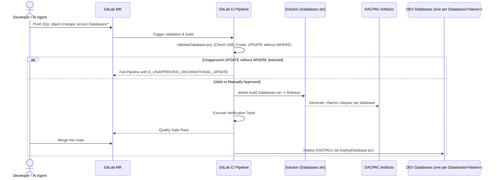

# SPEC-001: Multi-Database SQL Server DevOps, Schema Management & Safety Guardrails Platform

## Metadata

| Field | Value |
|---|---|
| ID | SPEC-001 |
| Title | Multi-Database SQL Server DevOps, Schema Management & Safety Guardrails Platform |
| Status | Approved |
| Version | 3.0.1 |
| Author | Antigravity |
| Owner | Maintainer |
| Dependencies | none |
| Created | 2026-10-07 |
| Last Updated | 2026-10-17 |

---

## 1. Problem Statement & Motivation

### 1.1 Problem
In traditional SQL Server enterprise development, database changes are frequently made directly on live environments using SQL Server Management Studio (SSMS). This practice causes critical discrepancies: stored procedures and tables exist only in live databases, DEV/TEST/PROD environments drift apart, column additions break calling applications without warning, and changes lack review, automated testing, or audit history. Furthermore, managing any number of distinct databases within a single pipeline requires clear directory isolation and dedicated build targets, without editing scripts or the pipeline each time a database is added. Crucially, executing unconditional `UPDATE` statements (queries lacking a `WHERE` clause) presents an extreme risk of catastrophic data corruption, requiring stringent manual approval guardrails before deployment.

### 1.2 Goals
- G1: Establish the Git repository as the authoritative single source of truth for all database schemas, stored procedures, views, functions, indexes, and constraints.
- G2: Package database objects into declarative MSBuild SQL Database Projects producing immutable DACPAC build artifacts.
- G3: Automate validation, linting, and build verification on every GitLab Merge Request.
- G4: Support automated DACPAC deployment to DEV upon merge and scheduled drift detection.
- G5: Implement scheduled and on-demand database schema drift detection to alert maintainers when live databases deviate from the Git baseline.
- G6: Extract and onboard existing enterprise database schemas safely without loss or unintended schema alterations.
- G7: Guard against catastrophic mass updates: an `UPDATE` query without a `WHERE` clause needs explicit approval: `-- @manual-approve: <reason>` in `Databases/` files, and a person's approval in CI before a `ScriptRunner/` script runs it.
- G8: Support a multi-database architecture for any SQL Server database: each database is a folder `Databases/<Name>/` with its own `<Name>.sqlproj`, listed in the root `Databases.sln`. Scripts discover databases from this layout and accept `-Database All`, so adding a database needs no script or pipeline change. The repository ships one example database, `SampleDb`.
- G10: Automatically record deployment execution history (status SUCCESS/FAILED, commit SHA, branch, author, pipeline URL, duration, and error details) into the target database `[dbo].[DeploymentLog]` table upon deployment completion.

### 1.3 Non-Goals
- NG1: Replacing SQL Server itself or providing general-purpose SSMS database administration replacements.
- NG2: Managing or migrating application transactional runtime data (this project manages schema and programmability definitions).
- NG3: Automatically rewriting or generating application business logic in consumer repositories.
- NG4: Committing database passwords or plaintext credentials to source control.
- NG5: Unrestricted or unapproved production deployments without change approval gates.
- NG6: Allowing silent execution of unconditional `UPDATE` statements without manual approval.

### 1.4 Open Questions
| # | Question | Owner | Resolution |
|---|---|---|---|
| Q1 | Should extraction of an existing database run immediately or await production network access credentials? | Maintainer | `ExtractDatabase.ps1 -Database <Name>` runs when credentials are provided. |
| Q2 | Which GitLab CI/CD runner environment will execute `sqlpackage`? | Maintainer | Docker container with `mcr.microsoft.com/dotnet/sdk:10.0` + SqlPackage tool. |
| Q3 | Are there cross-database references between managed databases? | Maintainer | Standard SQL project database references (.dacpac / Master dacpac) can be added as needed. |

### 1.5 Assumptions
- A1: The target SQL Server version is SQL Server 2019/2022 compatibility level (`Sql160DatabaseSchemaProvider`).
- A2: Maintainers will provide connection credentials via GitLab CI/CD masked variables per database, `DEV_CONNECTION_STRING_<DATABASE>` (the name upper-cased, characters other than `A-Z`, `0-9` and `_` replaced by `_`; e.g. `DEV_CONNECTION_STRING_SAMPLEDB`).
- A3: The .NET SDK (8.0/10.0) is installed and available to compile `.sqlproj` projects referencing `Microsoft.Build.Sql`.
- A4: Any legitimate unconditional bulk update in `Databases/` must be marked with `-- @manual-approve: <reason>` directly preceding the query.

---

## 2. Architectural Boundaries & Data Flow

### 2.1 Module Placement
| Layer | Path(s) owned by this spec | Responsibility |
|---|---|---|
| domain | `Databases/<Name>/Tables/`, `Databases/<Name>/Views/`, `Databases/<Name>/Functions/` | Schema definition, domain entities, constraints, views per database |
| core | `Databases/<Name>/StoredProcedures/`, `Databases/<Name>/Deployment/` | Programmable use cases, business routines, pre/post deployment scripts |
| data | `Scripts/`, `Databases/<Name>/<Name>.sqlproj`, `Databases.sln` | SqlPackage build, extract, publish, drift detection adapters, and multi-database solution |
| interfaces | `.gitlab-ci.yml`, `Tests/` | GitLab CI/CD pipeline entrypoints, automated MR validation gates, test suites |

### 2.2 Data Flow


### 2.3 External Dependencies
| Dependency | Purpose | Failure mode | Timeout |
|---|---|---|---|
| Microsoft SQL Server 2019/2022 | Target database platform | Connection failure / query timeout | 30s |
| SqlPackage CLI | DACPAC extraction, compilation, publish, drift detection | Tool execution error | 600s |
| .NET SDK / MSBuild | Building `.sqlproj` projects and solution | Build compilation error | 180s |
| GitLab CI/CD | Pipeline execution and secret injection | Pipeline job failure | 1200s |

### 2.4 Decisions
| # | Decision | Alternatives considered | Rationale |
|---|---|---|---|
| D1 | Use SDK-style `.sqlproj` (`Microsoft.Build.Sql`) | Legacy MSBuild SSDT, Flyway, DbUp, Liquibase | Declarative state-based model is native to SQL Server, handles dependency ordering automatically, and works cross-platform via .NET SDK. |
| D2 | Separate database objects into granular single-file SQL scripts | Monolithic schema script | Granular files allow precise Git version tracking, conflict-free MR reviews, and AI agent tool integration. |
| D3 | Promote single compiled DACPAC artifact across environments | Environment-specific build artifacts | Ensures that the exact tested binary artifact deployed to DEV/TEST is the one promoted to PROD. |
| D4 | Explicit approval for UPDATE queries without WHERE clause: inline annotation in `Databases/`, a person's approval in CI for `ScriptRunner/` scripts | Unrestricted execution, total static ban, both gates on every change | Mass updates can wipe entire table datasets. Object definitions are rechecked on every pipeline, so a code comment (`-- @manual-approve: <reason>`) records intent once; a one-time data script is approved by a person in CI right before it runs. |
| D5 | Multi-database architecture under `Databases/` with `Databases.sln` | Separate Git repositories, single merged database project | Houses distinct databases in isolated folders `Databases/<Name>/` while enabling unified builds via `Databases.sln` and deployment of one database (`-Database <Name>`) or all of them (`-Database All`). |
| D7 | Support ALTER and CREATE OR ALTER syntax in stored procedure files | Strict CREATE-only authoring | Developers can write ALTER or CREATE OR ALTER for existing or new procedures. BuildDatabase.ps1 temporarily normalizes them to CREATE for DacFx compilation and restores them post-build, while SqlPackage dynamically executes ALTER for existing objects and CREATE for new objects during deployment. |
| D8 | Automated deployment logging via dbo.DeploymentLog table | Local-only text logs, third-party APM | DeployDatabase.ps1 automatically inserts execution metadata (commit SHA, branch, author, pipeline URL, status SUCCESS/FAILED, duration, and error message) into the target database's [dbo].[DeploymentLog] table for end-to-end deployment auditability. |

---

## 3. Data Schemas & API Contracts

### 3.1 Entities & Value Objects
```ts
// Multi-Database Solution and Object Representation

interface MultiDatabaseSolution {
  solutionFile: string;          // 'Databases.sln'
  databases: DatabaseProject[];
}

interface DatabaseProject {
  name: string;                  // folder name under Databases/, e.g. 'SampleDb'
  projectFile: string;           // 'Databases/<name>/<name>.sqlproj'
  objectFolders: string[];       // ['Tables', 'StoredProcedures', 'Views', 'Functions', ...]
  preDeployScript: string;       // 'Databases/<name>/Deployment/PreDeployment.sql'
  postDeployScript: string;      // 'Databases/<name>/Deployment/PostDeployment.sql'
  outputDacpac: string;          // 'bin/Release/<name>.dacpac'
}

interface UpdateQueryApprovalPolicy {
  queryPattern: string;          // UPDATE <table> SET ... without WHERE
  approvalTag: string;           // '-- @manual-approve: <reason>'
  status: 'Approved' | 'Rejected';
}

interface DeploymentLogRecord {
  deploymentId: number;          // BIGINT IDENTITY(1, 1) PK
  databaseName: string;          // managed database name, e.g. 'SampleDb'
  targetEnvironment: string;     // 'Development' | 'Staging' | 'Production'
  status: 'SUCCESS' | 'FAILED' | 'ROLLED_BACK';
  deployedAtUtc: string;         // ISO-8601 UTC
  completedAtUtc?: string;       // ISO-8601 UTC
  durationSeconds?: number;      // Execution elapsed seconds
  commitSha: string;             // 40-character Git SHA
  commitShortSha: string;        // 7-10 character Git short SHA
  commitBranch: string;          // 'main'
  commitTitle?: string;          // Commit message
  commitAuthor?: string;         // Author name and email
  pipelineId?: string;           // GitLab CI pipeline ID
  pipelineUrl?: string;          // Web URL to pipeline run
  jobId?: string;                // GitLab CI job ID
  triggeredBy?: string;          // GitLab user who triggered run
  dacpacVersion?: string;        // DACPAC artifact name
  errorMessage?: string;         // Error message if status FAILED
  deployReportSummary?: string;  // Diff operations summary
}
```

### 3.2 Operations / API
| Operation | Input | Output | Errors (§4.2 codes) | Auth | Idempotent |
|---|---|---|---|---|---|
| `ValidateDatabase` | TargetPath, Database, FailOnUnapprovedUpdate | Validation Report | `E_VALIDATION`, `E_UNAPPROVED_UNCONDITIONAL_UPDATE` | Local / CI | yes |
| `BuildDatabase` | Database (`<Name>` or 'All'), Configuration | DACPAC binary / binaries | `E_BUILD_FAILED`, `E_SYNTAX_ERROR`, `E_DATABASE_NOT_FOUND` | Local / CI | yes |
| `DeployDatabase` | Database (`<Name>` or 'All'), TargetEnvironment, ConnectionString, BlockOnPossibleDataLoss | Deployment Log / Report & `[dbo].[DeploymentLog]` row | `E_DEPLOY_FAILED`, `E_DRIFT_DETECTED`, `E_DATABASE_NOT_FOUND` | CI Deploy Account | yes |
| `DetectDrift` | Database, TargetConnStr, DacpacPath | Drift XML / Summary | `E_DB_UNAVAILABLE`, `E_DRIFT_DETECTED`, `E_DATABASE_NOT_FOUND` | CI Read Account | yes |
| `ExtractDatabase` | Database, ConnectionString, TargetFile | DACPAC binary | `E_DB_UNAVAILABLE`, `E_EXTRACT_FAILED`, `E_DATABASE_NOT_FOUND` | DB Admin / DBO | yes |

### 3.3 Persistence
- Objects are stored as individual `.sql` files within their respective database directory `Databases/<Name>/`.
- Git repository history persists all state transitions.
- SqlPackage registers deployment state in SQL Server `[dbo].[__DacVersion]` and `sysdac_instances` per database.
- Deployment outcomes (SUCCESS / FAILED) are persisted in `[dbo].[DeploymentLog]` with page compression and column-level `MS_Description` extended properties across all managed databases.

### 3.4 Compatibility & Migration
- The repository ships one example database, `Databases/SampleDb/` (the `dbo.DeploymentLog` table, deployment scripts and one stored procedure), to be renamed or replaced.
- A database is added by copying a database folder, renaming the folder and its `.sqlproj` to the database name, and adding the project to `Databases.sln`. The `.sqlproj` takes its name from its file name, so it needs no edits.
- An existing live database is onboarded by extracting it into `Databases/<Name>/` (see `docs/Getting-Started.md`); `ExtractDatabase.ps1` extracts a baseline DACPAC.
- Root `Databases.sln` binds every database project.

---

## 4. Error Modes, Invariants & Edge Cases

### 4.1 Invariants
| ID | Invariant |
|---|---|
| INV-01 | Git is the single source of truth; if an object is not in Git, it does not officially exist in the database. |
| INV-02 | Every stored procedure, table, view, and function must reside in its own dedicated, schema-qualified `.sql` file under `Databases/<DbName>/`. |
| INV-03 | No manual schema modifications are permitted on TEST or PROD environments. |
| INV-04 | The same DACPAC artifact tested in DEV/TEST must be promoted to PROD per database. |
| INV-05 | No production credentials or connection strings may be committed to Git. |
| INV-06 | Every `UPDATE` query lacking a `WHERE` clause must be explicitly approved before deployment: in `Databases/` by an inline `-- @manual-approve: <reason>` annotation, in a `ScriptRunner/` script by a person running the manual CI approval before the script runs. |
| INV-07 | Every managed database must reside in its own folder `Databases/<Name>/` holding `<Name>.sqlproj` and its schema structure. Scripts discover the managed databases from this layout, never from a hardcoded list; a `-Database` naming no such folder fails with `E_DATABASE_NOT_FOUND`. |
| INV-09 | Stored procedure definitions in `Databases/*/StoredProcedures/` may be authored using `CREATE PROCEDURE`, `ALTER PROCEDURE`, or `CREATE OR ALTER PROCEDURE`; build automation temporarily normalizes them for DacFx compilation while preserving source files, and SqlPackage dynamically applies `ALTER` or `CREATE` at deployment. |
| INV-10 | Every deployment executed via DeployDatabase.ps1 automatically records an execution history record with status SUCCESS or FAILED in the target database [dbo].[DeploymentLog] table. |

### 4.2 Error Modes
| Code | Trigger | Caller receives | Retryable | Side effects / state after |
|---|---|---|---|---|
| `E_SYNTAX_ERROR` | SQL syntax or invalid object reference during build | Build error output | no | Build aborted, no DACPAC generated |
| `E_VALIDATION` | Violation of SQL coding standards (missing `SET NOCOUNT ON`, `USE <db>`) | Linter failure | no | MR gate blocks merge |
| `E_UNAPPROVED_UNCONDITIONAL_UPDATE` | `UPDATE` statement detected without a `WHERE` clause and without `-- @manual-approve:` | Linter failure with line and file details | no | Merge blocked until query is revised or approved |
| `E_DATABASE_NOT_FOUND` | Script executed with invalid or unknown `-Database` parameter | Parameter error message | no | Execution halts without action |
| `E_DEPLOY_FAILED` | SqlPackage deployment transaction fails | SqlPackage error log | yes (after fix) | Automatic transaction rollback to previous state |
| `E_DRIFT_DETECTED` | Target database schema differs from DACPAC definition | Drift report diff | no | Alert triggered for human investigation |
| `E_DB_UNAVAILABLE` | SQL Server instance unreachable or timeout | Connection timeout | yes (backoff) | No state modification |

### 4.3 Edge Cases
| ID | Scenario | Expected behavior |
|---|---|---|
| EC-01 | Table column renamed in Git | Pre-deployment script or `BlockOnPossibleDataLoss=true` flags potential data loss; manual script required. |
| EC-02 | Stored procedure references deleted table | DACPAC compiler flags unresolved object reference at build time, failing the pipeline before deployment. |
| EC-03 | Emergency hotfix applied to PROD directly | Drift detection flags anomaly; emergency hotfix process requires immediate reconciliation commit to Git. |
| EC-04 | High object volume (5,000+ objects in one database) | Build and extract scripts optimize batching and memory allocation to prevent timeouts. |
| EC-05 | `UPDATE` query has a `WHERE` clause inside an embedded subquery or comment | Regex/parser correctly checks for top-level statement termination and `WHERE` presence. |
| EC-06 | One database project compiles while another fails in `Databases.sln` | Build halts with exit code 1; no partial deployments proceed. |

### 4.4 Security & Privacy
- **Least Privilege:** Deployment pipelines use dedicated service accounts with DDL-only administrative privileges where feasible.
- **Credential Storage:** Secrets must be stored in GitLab CI/CD protected variables named per database (`DEV_CONNECTION_STRING_<DATABASE>`).
- **Data Protection:** No actual production data is pulled into the Git repository during schema extraction.

### 4.5 Non-Functional Requirements
- Build duration: Multi-database DACPAC compilation under 180 seconds.
- Validation gate: Static SQL analysis completed within 60 seconds across all databases.
- Drift detection: Scheduled execution daily or on-demand within 300 seconds per database.

---

## 5. Verification Matrix

| AC ID | Criterion (Given / When / Then) | Covers | Test Reference | Status |
|---|---|---|---|---|
| AC-01 | **Given** database object definitions in `Databases/` **When** built via `dotnet build Databases.sln` **Then** DACPAC compiles and generates valid binary for all projects | G1, G2, G8 | Tests/VerificationTests.ps1 | Verified |
| AC-02 | **Given** the stored procedures in `Databases/<Name>/StoredProcedures/` of every managed database **When** code is validated **Then** each follows `SET NOCOUNT ON` and schema qualification | G1, G2, INV-02 | Tests/VerificationTests.ps1 | Verified |
| AC-03 | **Given** the managed databases **When** the source tree is checked **Then** each has `Deployment/PreDeployment.sql` and `Deployment/PostDeployment.sql` | G1, G2, G8 | Tests/VerificationTests.ps1 | Verified |
| AC-04 | **Given** an invalid SQL syntax or forbidden `USE` statement (comments are ignored, so `-- use this` passes) **When** validation script runs **Then** compilation or validation fails (`E_VALIDATION`) | G3, E_SYNTAX_ERROR | Tests/VerificationTests.ps1 | Verified |
| AC-05 | **Given** a stored procedure missing `SET NOCOUNT ON` **When** validation script runs **Then** validation fails (`E_VALIDATION`) | G3, E_VALIDATION | Tests/VerificationTests.ps1 | Verified |
| AC-06 | **Given** a destructive schema change causing data loss **When** deployment runs without bypass **Then** SqlPackage blocks deployment | INV-03, EC-01 | Tests/VerificationTests.ps1 | Verified |
| AC-07 | **Given** the GitLab CI pipeline **When** executed on main **Then** DACPAC is deployed only to Development and test/prod deployment jobs are omitted | G4, INV-03 | Tests/VerificationTests.ps1 | Verified |
| AC-08 | **Given** an artifact build in CI **When** promoted across environments **Then** the exact same DACPAC binary is published | G4, INV-04 | Tests/VerificationTests.ps1 | Verified |
| AC-09 | **Given** repository source files **When** scanned for passwords and connection strings **Then** zero credentials are found in Git | INV-05 | Tests/VerificationTests.ps1 | Verified |
| AC-10 | **Given** an unauthorized manual table change on SQL Server **When** drift detection runs **Then** `E_DRIFT_DETECTED` is raised with a diff report | G5, EC-03 | Tests/VerificationTests.ps1 | Verified |
| AC-11 | **Given** an existing database **When** `ExtractDatabase.ps1 -Database <Name>` executes **Then** its schema is extracted into a DACPAC | G6, EC-04 | Tests/VerificationTests.ps1 | Verified |
| AC-12 | **Given** a SQL file containing an `UPDATE` without a `WHERE` clause and no approval comment **When** `ValidateDatabase.ps1` runs **Then** validation fails with `E_UNAPPROVED_UNCONDITIONAL_UPDATE` | G7, INV-06, E_UNAPPROVED_UNCONDITIONAL_UPDATE | Tests/VerificationTests.ps1 | Verified |
| AC-13 | **Given** a SQL file containing an `UPDATE` without a `WHERE` clause accompanied by `-- @manual-approve: <reason>` **When** `ValidateDatabase.ps1` runs **Then** validation succeeds | G7, INV-06 | Tests/VerificationTests.ps1 | Verified |
| AC-14 | **Given** the multi-database directory structure **When** verified **Then** every `Databases/<Name>/` holding `<Name>.sqlproj` is listed in `Databases.sln`, and a name with no such folder fails with `E_DATABASE_NOT_FOUND` | G8, INV-07 | Tests/VerificationTests.ps1 | Verified |
