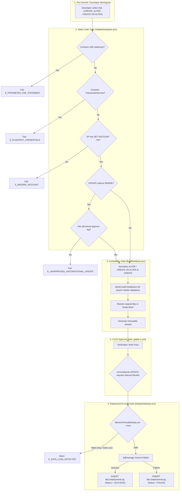

# SPEC-002: Database Constraints, Static Checks & CI/CD Safety Guardrails

## Metadata

| Field | Value |
|---|---|
| ID | SPEC-002 |
| Title | Database Constraints, Static Checks & CI/CD Safety Guardrails |
| Status | Approved |
| Version | 3.0.1 |
| Author | Antigravity |
| Owner | Maintainer |
| Dependencies | SPEC-001 |
| Created | 2026-10-08 |
| Last Updated | 2026-10-17 |

---

## 1. Problem Statement & Motivation

### 1.1 Problem
In enterprise SQL Server environments, database modifications are vulnerable to critical risks: accidental unconditional bulk updates (`UPDATE` without `WHERE`) wiping out entire tables, hardcoded environment-specific `USE <db>` statements breaking CI/CD portability, missing `SET NOCOUNT ON;` degrading network and cursor throughput, unresolved object references failing silently until runtime, and schema drift occurring undetected. Furthermore, syntax conflicts between developer SSMS authoring (`ALTER` / `CREATE OR ALTER`) and declarative DacFx compilers (`SQL70001`) cause pipeline disruption. A codified specification of all declarative schema constraints, static analysis rules, compile-time checks, and automated deployment guardrails is necessary to guarantee database stability and auditability.

### 1.2 Goals
- G1: Enforce static linter checks preventing prohibited `USE <database>` statements and plaintext credentials across all SQL files.
- G2: Enforce mandatory `SET NOCOUNT ON;` and two-part schema qualification (`[schema].[object]`) on all stored procedure definitions.
- G3: Prevent catastrophic mass updates: an `UPDATE` without a `WHERE` clause in `Databases/` is rejected unless annotated with `-- @manual-approve: <reason>`; in a `ScriptRunner/` script it waits for a person's approval (G11).
- G4: Support developer authoring in `ALTER PROCEDURE`, `CREATE OR ALTER PROCEDURE`, and `CREATE PROCEDURE` via transparent pre-build normalization without DacFx `SQL70001` compiler errors.
- G5: Enforce declarative schema constraints (primary keys, foreign keys, explicit default constraint naming, and page data compression on audit/log tables).
- G6: Protect target databases against accidental data loss during deployment by enforcing `BlockOnPossibleDataLoss = true`.
- G7: Maintain end-to-end deployment auditability by automatically logging all deployment outcomes (`SUCCESS` or `FAILED`) with Git metadata and duration into `[dbo].[DeploymentLog]`.
- G8: Detect unauthorized manual out-of-band database schema modifications via scheduled and on-demand drift inspection (`DetectDrift.ps1`).
- G9: Record individual deployed SQL script file names in `[dbo].[DeploymentLog]` (`ScriptName`), inserting one row per `.sql` file in a commit and filtering out non-SQL file changes.
- G10: Enforce strict database connection isolation so that each database uses only its own connection string (`DEV_CONNECTION_STRING_<DATABASE>`), preventing cross-database deployment.
- G11: On `main`, a deploy that would run a `ScriptRunner/` script that has not run yet and contains a risky statement (a SPEC-003 rule whose Production action is `block` or `requireApproval`: `UPDATE`/`DELETE` without `WHERE`, `DROP DATABASE`, permanent `DROP TABLE`, `TRUNCATE TABLE`, `DROP COLUMN`, `DROP PROCEDURE`, `DROP VIEW`) waits until a person allowed to merge to `main` runs the manual job `deploy_dev_approved`, even when the statement has an approval comment. Scripts that already ran never ask again; everything else deploys automatically.

### 1.3 Non-Goals
- NG1: Replacing application-tier domain and business validation rules.
- NG2: Banning intentional bulk administrative updates when legitimately annotated and approved.
- NG3: Managing or migrating transactional business data contents.
- NG4: Committing database passwords or plaintext credentials to source control.

### 1.4 Open Questions
| # | Question | Owner | Resolution |
|---|---|---|---|
| Q1 | Should `ValidateDatabase.ps1` fail or warn on missing schema qualification? | Maintainer | Schema qualification is strictly mandatory for all object definitions and actions; emits ERROR and halts on violation. |
| Q2 | Should `DeployDatabase.ps1` create `dbo.DeploymentLog` automatically if missing on the target? | Maintainer | Yes, dynamically verifies and creates table if missing before inserting deployment record. |

### 1.5 Assumptions
- A1: Target SQL Server instances run compatibility level 150/160 (SQL Server 2019/2022).
- A2: GitLab CI runners execute within Docker containers equipped with .NET SDK 8.0 and SqlPackage.
- A3: Any intentional bulk update in `Databases/` is preceded directly by `-- @manual-approve: <reason>`.

---

## 2. Architectural Boundaries & Data Flow

### 2.1 Module Placement
| Layer | Path(s) owned by this spec | Responsibility |
|---|---|---|
| domain | `Databases/*/Tables/`, `Databases/*/StoredProcedures/` | Declarative table constraints (PK, FK, DF), stored procedure syntax |
| core | `Scripts/ValidateDatabase.ps1`, `Scripts/BuildDatabase.ps1` | Static analysis linting rules, pre-build SP normalization engine |
| data | `Scripts/DeployDatabase.ps1`, `Scripts/DetectDrift.ps1` | Deployment safety gates (`BlockOnPossibleDataLoss`), drift inspection, audit logging |
| interfaces | `.gitlab-ci.yml`, `Tests/VerificationTests.ps1` | GitLab CI quality gates, manual approval jobs, automated test verification suite |

### 2.2 Data Flow & Guardrail Pipeline


### 2.3 External Dependencies
| Dependency | Purpose | Failure mode | Timeout |
|---|---|---|---|
| Microsoft SQL Server 2019/2022 | Target database hosting tables & programmability | Connection error | 30s |
| SqlPackage CLI | DACPAC validation, publish, and drift detection | Process execution failure | 600s |
| .NET SDK / MSBuild | Compiling SDK-style SQL projects | MSBuild compilation error | 180s |
| ADO.NET SqlClient | Logging deployment execution records to `[dbo].[DeploymentLog]` | Connection failure / warning logged | 15s |

### 2.4 Decisions
| # | Decision | Alternatives considered | Rationale |
|---|---|---|---|
| D1 | Static regex AST-like parser for unconditional `UPDATE` queries | Total ban, manual PR review only | Regex statement splitting strips comments, isolates `UPDATE <table> SET` statements, and checks for `WHERE` or explicit `-- @manual-approve: <reason>`. |
| D2 | Pre-build syntax normalization with post-build file restoration | Permanent file rewriting, rejecting `ALTER` | SSDT DacFx strictly requires declarative `CREATE PROCEDURE`. Normalizing temporarily during compilation and restoring in a `finally` block allows developers to author in `ALTER` or `CREATE OR ALTER` without breaking builds or dirtying Git trees. |
| D3 | Explicit intent for unconditional updates: `-- @manual-approve: <reason>` in `Databases/`, a person's approval in CI for `ScriptRunner/` scripts (D6) | Single gate; bypass parameter; a manual CI job triggered by commit-message keywords (`approve_unconditional_updates`, removed 2026-10-11) | Mass updates can wipe whole tables. `Databases/` files are object definitions checked on every pipeline, so a comment records intent once; a `ScriptRunner/` script runs once at deploy, so a person approves that run. The commit-message job fired on the commit text, not on the SQL. |
| D4 | Automated deployment logging directly into target database table `[dbo].[DeploymentLog]` | File-only text logs, third-party APM | Stores immutable deployment history (commit SHA, branch, author, pipeline URL, status, duration, error message) natively inside each target database for complete traceability. |
| D5 | Enforce `BlockOnPossibleDataLoss = true` by default | Manual flags, disabled by default | Prevents inadvertent table truncations, column drop operations, or incompatible datatype conversions during automated CD deployments. |
| D6 | Decide approval before deploy with `check_scripts` (`main` only): it reads `dbo.DeploymentLog` and checks only the `ScriptRunner/` scripts that have not run; when it lists risky statements, `approval_required` (`on_failure`) unlocks the manual `deploy_dev_approved` | Check the whole folder (scripts that already ran ask again on every pipeline); check only files changed in the push (a script whose pipeline was never approved would run unapproved in a later deploy); approve any failed validation (would also approve syntax errors and credentials) | Only scripts that have not run can execute, and that set only shrinks between check and deploy, so nothing runs unapproved and nothing is approved twice. GitLab cannot make a job manual only after a failure, so `approval_required` runs `on_failure` and succeeds only when an `artifacts/approval-required-<Database>.txt` exists; any other `check_scripts` failure fails the pipeline. |

---

## 3. Data Schemas & API Contracts

### 3.1 Entities & Value Objects
```ts
// Validation & Linter Rule Definitions

interface LintRule {
  ruleId: string;               // e.g. 'RULE-USE-STMT', 'RULE-NOCOUNT', 'RULE-UNCONDITIONAL-UPDATE'
  description: string;
  severity: 'ERROR' | 'WARN';
  pattern: string;
  failureCode: string;
}

interface ValidationReport {
  targetPath: string;
  databaseScope: string;        // a managed database name or 'All'
  scannedFiles: number;
  errors: number;
  warnings: number;
  violations: RuleViolation[];
}

interface RuleViolation {
  file: string;
  ruleId: string;
  severity: 'ERROR' | 'WARN';
  message: string;
  line?: number;
}

// Table Schema Constraints Definition

interface TableSchemaConstraints {
  primaryKey: {
    column: string;
    type: 'BIGINT' | 'INT' | 'NVARCHAR';
    isIdentity: boolean;
    clustered: boolean;
  };
  defaultConstraints: {
    column: string;
    constraintName: string;     // Must follow DF_<Table>_<Column> pattern
    expression: string;
  }[];
  compression: 'NONE' | 'ROW' | 'PAGE';
}

// Deployment Audit Log Entity

interface DeploymentLogRecord {
  deploymentId: number;          // BIGINT IDENTITY(1, 1) PK
  databaseName: string;          // managed database name, e.g. 'SampleDb'
  targetEnvironment: string;     // 'Development' | 'Staging' | 'Production'
  status: 'SUCCESS' | 'FAILED' | 'ROLLED_BACK';
  deployedAtUtc: string;         // ISO-8601 UTC
  completedAtUtc?: string;       // ISO-8601 UTC
  durationSeconds?: number;      // Execution elapsed seconds
  scriptName?: string;           // Deployed SQL script file name (e.g. dbo.Customer.sql)
  commitSha: string;             // 40-character Git SHA
  commitShortSha: string;        // 7-10 character Git short SHA
  commitBranch: string;          // 'main'
  commitTitle?: string;          // Commit message
  commitAuthor?: string;         // Author name and email
  pipelineId?: string;           // GitLab CI pipeline ID
  pipelineUrl?: string;          // Web URL to pipeline run
  jobId?: string;                // GitLab CI job ID
  triggeredBy?: string;          // GitLab user who triggered run
  dacpacVersion?: string;        // DACPAC artifact name
  errorMessage?: string;         // Error message if status FAILED
  deployReportSummary?: string;  // Diff operations summary
}
```

### 3.2 Operations / API
| Operation | Input | Output | Errors (§4.2 codes) | Auth | Idempotent |
|---|---|---|---|---|---|
| `ValidateDatabase.ps1` | `-Database`, `-TargetDir` | Validation exit code (0 = pass, 1 = fail) | `E_VALIDATION`, `E_UNAPPROVED_UNCONDITIONAL_UPDATE`, `E_PROHIBITED_USE_STATEMENT`, `E_MISSING_NOCOUNT` | Local / CI | yes |
| `BuildDatabase.ps1` | `-Database`, `-Configuration` | DACPAC binary (`bin/Release/*.dacpac`) | `E_BUILD_FAILED`, `E_SYNTAX_ERROR` | Local / CI | yes |
| `DeployDatabase.ps1` | `-Database`, `-TargetEnvironment`, `-ConnectionString`, `-BlockOnPossibleDataLoss` | Deployment Report & `dbo.DeploymentLog` row | `E_DEPLOY_FAILED`, `E_DATA_LOSS_DETECTED` | CI Deploy Account | yes |
| `DetectDrift.ps1` | `-Database`, `-ConnectionString`, `-ReportPath` | Drift Report XML | `E_DRIFT_DETECTED`, `E_DB_UNAVAILABLE` | CI Read Account | yes |

### 3.3 Implemented Checks & Rules Catalog

| Rule ID | Check Name | Target Object | Enforcement Mechanism | Severity | Action on Violation |
|---|---|---|---|---|---|
| **CHK-01** | Prohibited `USE` Statement | All `.sql` files | Regex scan for `\bUSE\s+\[?\w+\]?` in `ValidateDatabase.ps1` | ERROR | Pipeline fails; merge blocked |
| **CHK-02** | Credential Leak Detection | All `.sql` files | Regex scan for `password\s*=`, `pwd\s*=`, private keys | ERROR | Pipeline fails; credentials scrubbed |
| **CHK-03** | Mandatory `SET NOCOUNT ON;` | `StoredProcedures/*.sql` | Regex scan for `SET\s+NOCOUNT\s+ON` in `ValidateDatabase.ps1` | ERROR | Pipeline fails; merge blocked |
| **CHK-04** | Schema Qualification | `StoredProcedures/`, `Tables/` | Regex scan for `\[?\w+\]?\.\[?\w+\]?` | WARN | Warning logged in MR output |
| **CHK-05** | Unconditional `UPDATE` Protection | All `.sql` files | Regex split on statements, verifies `WHERE` or `-- @manual-approve:` | ERROR | Pipeline fails unless approved |
| **CHK-06** | Manual Approval Pipeline Gate | GitLab CI pipeline on `main` | Job `deploy_dev_approved` (extends `deploy_dev`), `when: manual`, needs `approval_required`, `build_dacpac` and `test_database` | BLOCK | Deploy waits until a person runs it |
| **CHK-07** | Stored Procedure Syntax Normalization | `StoredProcedures/*.sql` | Regex detection of `ALTER` / `CREATE OR ALTER`, normalized to `CREATE` | AUTO-FIX | Normalized for DacFx, restored post-build |
| **CHK-08** | Object Dependency & Reference Check | Entire solution | MSBuild DacFx model verification | ERROR | Compile fails (`SQL71501`, etc.) |
| **CHK-10** | Data Loss Protection Gate | Target database publish | SqlPackage `/p:BlockOnPossibleDataLoss=true` | ERROR | Deploy transaction rolls back |
| **CHK-11** | Schema Drift Detection Gate | Target database vs DACPAC | SqlPackage `/Action:DeployReport` diff comparison | ALERT | Drift alert raised for investigation |
| **CHK-12** | Automated Deployment Audit Logging per SQL Script | `[dbo].[DeploymentLog]` | Inserts audit record per .sql file in commit under `Databases/<Database>/` with ScriptName; ignores other files, other databases' files, and `ScriptRunner/` scripts (logged by SPEC-004) | LOG | Outcome recorded in SQL table |
| **CHK-13** | Dedicated Database Connection Isolation | Target database publish / drift / extraction | Validates connection string against $Database and prevents cross-database fallback | ERROR | Deployment halts if Initial Catalog mismatches target database |
| **CHK-14** | Risky Script Detection | `ScriptRunner/` scripts not yet run, on `main` | `check_scripts` runs `Invoke-ScriptRunner.ps1 -Database All -CheckOnly`, which lists risky statements in `artifacts/approval-required-<Database>.txt` per database and fails (every list is removed when any database failed for a reason no one can approve); `approval_required` prints that file | BLOCK | `deploy_dev` is skipped and CHK-06 waits for a person |

---

## 4. Error Modes, Invariants & Edge Cases

### 4.1 Invariants
| ID | Invariant |
|---|---|
| INV-01 | No `.sql` file in the repository may contain a `USE <db>` statement. |
| INV-02 | No passwords, connection strings, or private keys may exist in Git source code. |
| INV-03 | Every stored procedure must include `SET NOCOUNT ON;` to eliminate extraneous network packets. |
| INV-04 | Every database object definition must be schema-qualified (e.g. `[dbo].[ObjectName]`). |
| INV-05 | An `UPDATE` statement without a `WHERE` clause is strictly rejected unless preceded by `-- @manual-approve: <reason>`. |
| INV-06 | Stored procedures may be authored using `CREATE PROCEDURE`, `ALTER PROCEDURE`, or `CREATE OR ALTER PROCEDURE`; the build toolchain guarantees DacFx compilation while preserving source code. |
| INV-07 | Database deployments default to `BlockOnPossibleDataLoss = true` to protect production datasets. |
| INV-08 | Every deployment execution automatically logs its outcome (`SUCCESS` or `FAILED`) into `[dbo].[DeploymentLog]`. |
| INV-10 | `[dbo].[DeploymentLog]` contains a `ScriptName` column. A DACPAC deployment of `<Database>` records one row per `.sql` file under `Databases/<Database>/` that the deployment commit changed compared with its first parent (for a merge commit, everything the merge brought in); non-SQL files, other databases' files, and `ScriptRunner/` scripts are not recorded by the DACPAC deployment. |
| INV-11 | DeployDatabase.ps1, DetectDrift.ps1, and ExtractDatabase.ps1 strictly require dedicated, database-isolated connection strings for each managed database (`DEV_CONNECTION_STRING_<DATABASE>`). Shared fallback connections, a `-ConnectionString` with `-Database All`, and mismatched Initial Catalog values are rejected. |
| INV-12 | On `main`, `deploy_dev` runs only when `check_scripts` passes. When `check_scripts` lists risky statements, nothing deploys until a person runs `deploy_dev_approved`, and only after `build_dacpac` and `test_database` pass. Any other failure (validation, syntax error, `USE` of another database, credentials, unreachable database) fails the pipeline and cannot be approved. A `ScriptRunner/` script with a runner `SUCCESS` or `FAILED` row in `dbo.DeploymentLog` never asks again. Merge request pipelines don't run `check_scripts`. |

### 4.2 Error Modes
| Code | Trigger | Caller receives | Retryable | Side effects / state after |
|---|---|---|---|---|
| `E_PROHIBITED_USE_STATEMENT` | `USE <db>` statement found | Linter error message | no | Pipeline fails; merge blocked |
| `E_PLAINTEXT_CREDENTIALS` | Password or secret pattern detected | Linter error message | no | Pipeline fails; secret must be purged |
| `E_MISSING_NOCOUNT` | Stored procedure missing `SET NOCOUNT ON` | Linter error message | no | Pipeline fails; merge blocked |
| `E_UNAPPROVED_UNCONDITIONAL_UPDATE` | `UPDATE` without `WHERE` and no annotation | Linter error message | no | Pipeline fails; requires code edit or approval |
| `E_SYNTAX_ERROR` | DacFx model compilation error | MSBuild build failure | no | DACPAC build aborted |
| `E_DATA_LOSS_DETECTED` | SqlPackage flags table/column drop with data | Deployment failure message | no | Deployment transaction rolled back |
| `E_DRIFT_DETECTED` | Live database schema differs from Git DACPAC | Drift XML diff report | no | Human investigation alert triggered |
| `E_CONNECTION_MISMATCH` | Connection string targets wrong database (e.g. Initial Catalog does not match $Database) | Deployment failure message | no | Operation aborted, cross-database access prevented |

### 4.3 Edge Cases
| ID | Scenario | Expected behavior |
|---|---|---|
| EC-01 | `UPDATE` query has `WHERE` clause inside an embedded comment or string | Parser isolates SQL code blocks before verifying top-level `WHERE` keyword. |
| EC-02 | `UPDATE` query contains valid `-- @manual-approve: Data migration script` comment | Linter outputs INFO message and permits validation to pass. |
| EC-03 | Stored procedure uses `ALTER PROCEDURE` on an existing object | `BuildDatabase.ps1` normalizes to `CREATE` for DacFx, compiles DACPAC, restores file, and SqlPackage executes `ALTER` on deployment. |
| EC-04 | Stored procedure uses `CREATE OR ALTER PROCEDURE` on a new object | `BuildDatabase.ps1` normalizes to `CREATE` for DacFx, compiles DACPAC, restores file, and SqlPackage executes `CREATE` on deployment. |
| EC-05 | Deployment fails due to network timeout or permission error | `DeployDatabase.ps1` catches exception, writes `FAILED` record with stack trace into `dbo.DeploymentLog`, and exits with failure code. |
| EC-06 | `dbo.DeploymentLog` table does not exist on target database before first run | `DeployDatabase.ps1` executes `IF OBJECT_ID('dbo.DeploymentLog') IS NULL CREATE TABLE` before inserting record. |
| EC-07 | `deploy_dev_approved` is run twice, or while another pipeline deploys | It shares `deploy_dev`'s `resource_group`, so deploys run one at a time; a rerun applies no DACPAC diff and ScriptRunner skips scripts it already logged (SPEC-004 INV-03). |
| EC-08 | A pipeline waits for approval and a later push to `main` starts another one | The later `check_scripts` still finds the unapproved script not run and asks too; whichever approval runs first applies the script, and the other run skips it. |

---

## 5. Verification Matrix

| AC ID | Criterion (Given / When / Then) | Covers | Test Reference | Status |
|---|---|---|---|---|
| AC-01 | **Given** database projects in `Databases/` **When** compiled **Then** valid DACPAC binaries are produced for all projects | G1, CHK-08 | Tests/VerificationTests.ps1 | Verified |
| AC-02 | **Given** stored procedure definitions **When** validated **Then** schema qualification and `SET NOCOUNT ON` are verified across `CREATE`, `ALTER`, and `CREATE OR ALTER` | G2, G4, CHK-03, CHK-07 | Tests/VerificationTests.ps1 | Verified |
| AC-03 | **Given** the managed databases **When** inspected **Then** each has `Deployment/PreDeployment.sql` and `Deployment/PostDeployment.sql` | G1 | Tests/VerificationTests.ps1 | Verified |
| AC-04 | **Given** a SQL file containing `USE <db>` **When** `ValidateDatabase.ps1` runs **Then** validation fails with `E_PROHIBITED_USE_STATEMENT` | G1, CHK-01, INV-01 | Tests/VerificationTests.ps1 | Verified |
| AC-05 | **Given** a stored procedure missing `SET NOCOUNT ON` **When** `ValidateDatabase.ps1` runs **Then** validation fails with `E_MISSING_NOCOUNT` | G2, CHK-03, INV-03 | Tests/VerificationTests.ps1 | Verified |
| AC-06 | **Given** `DeployDatabase.ps1` **When** inspected **Then** `BlockOnPossibleDataLoss` defaults to `$true` | G6, CHK-10, INV-07 | Tests/VerificationTests.ps1 | Verified |
| AC-07 | **Given** `.gitlab-ci.yml` **When** inspected **Then** automated deployment is restricted strictly to Development | G1, INV-07 | Tests/VerificationTests.ps1 | Verified |
| AC-08 | **Given** `.gitlab-ci.yml` **When** inspected **Then** DACPAC build artifacts are preserved across pipeline stages | G1, G7 | Tests/VerificationTests.ps1 | Verified |
| AC-09 | **Given** repository source files **When** scanned for passwords and keys **Then** zero credentials are found in Git | G1, CHK-02, INV-02 | Tests/VerificationTests.ps1 | Verified |
| AC-10 | **Given** `DetectDrift.ps1` **When** inspected **Then** script supports drift inspection and Database parameter | G8, CHK-11 | Tests/VerificationTests.ps1 | Verified |
| AC-11 | **Given** `ExtractDatabase.ps1` **When** inspected **Then** script supports extraction per database | G1, CHK-08 | Tests/VerificationTests.ps1 | Verified |
| AC-12 | **Given** a SQL file with `UPDATE` without `WHERE` and no approval annotation **When** `ValidateDatabase.ps1` runs **Then** validation fails with `E_UNAPPROVED_UNCONDITIONAL_UPDATE` | G3, CHK-05, INV-05 | Tests/VerificationTests.ps1 | Verified |
| AC-13 | **Given** a SQL file with `UPDATE` without `WHERE` accompanied by `-- @manual-approve: <reason>` **When** `ValidateDatabase.ps1` runs **Then** validation succeeds | G3, CHK-05, INV-05 | Tests/VerificationTests.ps1 | Verified |
| AC-14 | **Given** multi-database structure **When** inspected **Then** every `Databases/<Name>/` has a dedicated `<Name>.sqlproj` listed in `Databases.sln` | G1, INV-09 | Tests/VerificationTests.ps1 | Verified |
| AC-16 | **Given** a deployment commit with file changes **When** DeployDatabase.ps1 logs deployment **Then** dbo.DeploymentLog records each .sql file under `Databases/<Database>/` with ScriptName and excludes non-SQL files, other databases' files, and `ScriptRunner/` scripts | G9, CHK-12, INV-10 | Tests/VerificationTests.ps1 | Verified |
| AC-17 | **Given** database deployment scripts and CI configuration **When** executed against a database **Then** only that database's dedicated connection is accepted and cross-database or fallback connections are rejected | G10, CHK-13, INV-11 | Tests/VerificationTests.ps1 | Verified |
| AC-18 | **Given** `.gitlab-ci.yml` **When** inspected **Then** `validate_sql` does not scan `ScriptRunner/` and `approve_unconditional_updates` is gone; `check_scripts` (stage `test`, `main` only) runs `Invoke-ScriptRunner.ps1 -CheckOnly` and keeps `artifacts/approval-required-*.txt` on failure; `approval_required` needs `check_scripts`, runs `on_failure` on `main` only and prints that file; `deploy_dev_approved` extends `deploy_dev`, is a blocking manual job on `main` only, and needs `approval_required`, `build_dacpac` and `test_database` | G3, G11, D3, D6, CHK-06, CHK-14, INV-12, EC-07, EC-08 | Tests/VerificationTests.ps1 | Verified |
