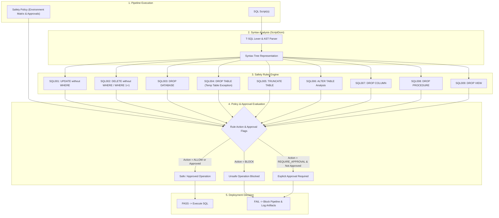

# SPEC-003: SQL Safety Validator & Automated Pipeline Guardrails

## Metadata

| Field | Value |
|---|---|
| ID | SPEC-003 |
| Title | SQL Safety Validator & Automated Pipeline Guardrails |
| Status | Approved |
| Version | 1.2.0 |
| Author | Antigravity |
| Owner | Maintainer |
| Dependencies | SPEC-001, SPEC-002 |
| Created | 2026-10-08 |
| Last Updated | 2026-10-11 |

---

## 1. Problem Statement & Motivation

### 1.1 Problem
In automated database deployment pipelines, raw or migrated SQL scripts can contain catastrophic operations—such as unconditional `UPDATE` or `DELETE` statements, dropping permanent tables or entire databases, dropping columns or constraints, and truncating tables. Relying solely on manual code reviews or naive regular expressions risks severe data loss, schema corruption, and deployment failures due to edge cases (such as `WHERE 1=1`, multi-line queries, comments, or temporary table drops). A dedicated, syntax-aware SQL Safety Validator is required to analyze SQL scripts before target database execution, enforce configurable policy gates per environment, and fail safe by default.

### 1.2 Goals
- G1: Analyze SQL scripts prior to database execution using AST/syntax-aware parsing (`Microsoft.SqlServer.TransactSql.ScriptDom`) rather than regex-only parsing.
- G2: Detect and block unconditional `UPDATE` statements (`SQL001`, CRITICAL) and unconditional `DELETE` statements (`SQL002`, CRITICAL).
- G3: Detect and block broad/trivial condition `DELETE` statements such as `WHERE 1=1` or `WHERE 1 = 1` (`SQL002`, CRITICAL).
- G4: Detect and govern `DROP DATABASE` operations (`SQL003`, CRITICAL) across environments based on policy hierarchy (Dev: requires explicit approval, Test: requires explicit approval, Staging: blocked by default, Prod: always blocked).
- G5: Detect and block `DROP TABLE` operations on permanent tables (`SQL004`, HIGH) while explicitly permitting drops on temporary tables (`#TableName`, `##TableName`).
- G6: Detect and govern `TRUNCATE TABLE` operations (`SQL005`, HIGH) requiring explicit approval or blocking based on environment policy.
- G7: Categorize `ALTER TABLE` operations (`SQL006`, MEDIUM), permitting non-destructive changes (`ADD COLUMN`) while identifying destructive operations (`DROP COLUMN` `SQL007`, `DROP CONSTRAINT`).
- G8: Detect and govern `DROP PROCEDURE` (`SQL008`, MEDIUM) and `DROP VIEW` (`SQL009`, MEDIUM) operations.
- G9: Apply an environment-aware policy defined in code (`Scripts/SqlSafety/Config/ConfigManager.ps1`): the action (`block`, `requireApproval`, `allow`) of each rule per environment (§3.3), plus granular approval flags passed with `-Approvals` or inline annotations.
- G10: Format standardized, human-readable terminal and artifact violation reports indicating exact file, line number, SQL operation, rule ID, severity, and reason.

### 1.3 Non-Goals
- NG1: Validating semantic business data consistency within application queries.
- NG2: Replacing DacFx/SSDT declarative schema model compilation.
- NG3: Silently auto-fixing or rewriting destructive SQL scripts without human intervention.
- NG4: Bypassing security validations when script parsing encounters syntax errors (parser errors must fail closed).

### 1.4 Open Questions
| # | Question | Owner | Resolution |
|---|---|---|---|
| Q1 | Should configuration support inline script comments (e.g. `-- @allow-rule: SQL001`) in addition to YAML configuration? | Maintainer | Supported via CLI approval flags (`-Approvals`) and inline annotations (`-- @manual-approve:` or `-- @allow-rule: <RuleId>`). (Amended 2026-10-11: the YAML config file was removed; see D5.) |
| Q2 | Should `ALTER TABLE ... DROP CONSTRAINT` have its own dedicated rule ID (e.g. `SQL010`) or remain grouped under `SQL006`? | Maintainer | Grouped under `SQL006` with `requireApproval` action per Section 9. |
| Q3 | When `ScriptDom` assembly is not pre-installed on lightweight runners, should the validator fall back to an AST tokenizer or require the assembly? | Maintainer | Validator requires `Microsoft.SqlServer.TransactSql.ScriptDom` (shipped with SqlPackage and Microsoft.Build.Sql) and fails closed with `E_PARSER_UNAVAILABLE` when it cannot be loaded. (Amended 2026-10-11: the regex fallback was removed; see D6.) |

### 1.5 Assumptions
- A1: Scripts validated are T-SQL compatible scripts intended for Microsoft SQL Server instances.
- A2: Temporary tables adhere to standard SQL Server naming conventions (`#` for local temp tables, `##` for global temp tables).
- A3: CI/CD runners have PowerShell 7+ (`pwsh`) and .NET runtime capable of loading `Microsoft.SqlServer.TransactSql.ScriptDom`.

---

## 2. Architectural Boundaries & Data Flow

### 2.1 Module Placement
| Layer | Path(s) owned by this spec | Responsibility |
|---|---|---|
| core | `Scripts/SqlSafety/Parser/`, `Scripts/SqlSafety/Rules/` | ScriptDom T-SQL parser, rule inspectors (SQL001–SQL009) |
| data | `Scripts/SqlSafety/Config/`, `Scripts/SqlSafety/Reporting/` | Environment policy matrix and approval flags; console and JSON reports |
| interfaces | `Scripts/Test-SqlSafety.ps1`, `.gitlab-ci.yml` | Pipeline CLI entrypoint, GitLab CI safety validation job |

### 2.2 Data Flow


### 2.3 External Dependencies
| Dependency | Purpose | Failure mode | Timeout |
|---|---|---|---|
| `Microsoft.SqlServer.TransactSql.ScriptDom` | T-SQL AST parser and visitor engine | Not found: `E_PARSER_UNAVAILABLE`; syntax error: `E_SYNTAX_PARSE_ERROR` (both fail closed) | 15s |
| PowerShell 7+ (`pwsh`) | Automation script execution environment | Process termination | 300s |

### 2.4 Decisions
| # | Decision | Alternatives considered | Rationale |
|---|---|---|---|
| D1 | Use `Microsoft.SqlServer.TransactSql.ScriptDom` for syntactic analysis | Pure regular expressions, SQL parser micro-libraries | Regular expressions cannot reliably handle nested subqueries, CTEs, comments, string literals, and complex T-SQL dialects. `ScriptDom` provides official, comprehensive AST visitor capabilities. |
| D2 | Hierarchical environment-based policy matrix (Dev, Test, Staging, Prod) | Single global safety policy | Permissive operations on ephemeral development sandboxes (e.g. dropping dev test databases with approvals) must be strictly prohibited on production. |
| D3 | Granular approval flags per operation | Single global approval switch (`--force`) | A blanket bypass flag risks accidentally permitting unintended catastrophic drops when the intention was only to approve an unconditional update. |
| D4 | Dedicated temporary table exception handler for `#` and `##` tables | Whitelist configuration by table name | Temporary tables are an established SQL Server idiom for staging operations; recognizing `#` / `##` avoids blocking valid deployment and migration scripts. |
| D5 | Policy defined in code; no YAML config file | YAML file read by a hand-written parser | The file repeated the code defaults, the environment matrix overwrote most of it, and its `enabled` flags were never read. A policy change is a reviewed code change either way. |
| D6 | Require ScriptDom; no regex fallback | Regex tokenizer when ScriptDom is missing | ScriptDom ships with SqlPackage, which every pipeline job installs. A weaker check that may pass unsafe SQL is worse than failing closed. |

---

## 3. Data Schemas & API Contracts

### 3.1 Entities & Value Objects
```ts
// Rule identifiers
type RuleId =
  | 'SQL001' // UPDATE without WHERE
  | 'SQL002' // DELETE without WHERE / broad conditions
  | 'SQL003' // DROP DATABASE
  | 'SQL004' // DROP TABLE
  | 'SQL005' // TRUNCATE TABLE
  | 'SQL006' // ALTER TABLE destructive alterations
  | 'SQL007' // DROP COLUMN
  | 'SQL008' // DROP PROCEDURE
  | 'SQL009'; // DROP VIEW

type Severity = 'CRITICAL' | 'HIGH' | 'MEDIUM' | 'LOW';

type RuleAction = 'block' | 'requireApproval' | 'allow' | 'warn';

type TargetEnvironment = 'Development' | 'Test' | 'Staging' | 'Production';

interface RuleViolation {
  ruleId: RuleId;
  ruleName: string;
  file: string;
  line: number;
  column: number;
  statementSnippet: string;
  severity: Severity;
  action: RuleAction;
  reason: string;
  isApproved: boolean;
}

interface SafetyRuleConfig {
  action: RuleAction;
}

interface ApprovalSettings {
  allowUnconditionalUpdate: boolean;
  allowUnconditionalDelete: boolean;
  allowDropDatabase: boolean;
  allowDropTable: boolean;
  allowTruncateTable: boolean;
  allowDropColumn: boolean;
}

interface DatabaseSafetyConfig {
  environment: TargetEnvironment;
  rules: {
    updateWithoutWhere: SafetyRuleConfig;
    deleteWithoutWhere: SafetyRuleConfig;
    dropDatabase: SafetyRuleConfig;
    dropTable: SafetyRuleConfig;
    dropTemporaryTable: SafetyRuleConfig;
    truncateTable: SafetyRuleConfig;
    dropColumn: SafetyRuleConfig;
    dropProcedure: SafetyRuleConfig;
    dropView: SafetyRuleConfig;
  };
  approvals: ApprovalSettings;
}

interface ValidationReport {
  scannedFiles: number;
  totalViolations: number;
  blockedViolations: number;
  approvalRequiredViolations: number;
  allowedViolations: number;
  isPassed: boolean;
  violations: RuleViolation[];
}
```

### 3.2 Operations / API
| Operation | Input | Output | Errors (§4.2 codes) | Auth | Idempotent |
|---|---|---|---|---|---|
| `Test-SqlSafety.ps1` | `-TargetFiles` (string[]) or `-TargetPath` (string, default `Databases`), `-Environment` (TargetEnvironment), `-Approvals` (Hashtable or `name=true,...` string), `-ReportPath` (string, optional JSON report), `-ApprovalListPath` (string, optional; §3.4) | Exit code (0 = PASS, 1 = FAIL), `ValidationReport` | `E_VALIDATION_BLOCKED`, `E_APPROVAL_REQUIRED`, `E_SYNTAX_PARSE_ERROR`, `E_PARSER_UNAVAILABLE` | CI/CD Runner | yes |
| `Invoke-SqlSafetyParse` + `Evaluate-SqlSafetyRules` | `-SqlContent` (string), `-FileName` (string) | `RuleViolation[]` | `E_SYNTAX_PARSE_ERROR` | Internal Core | yes |
| `Format-SqlSafetyConsoleReport` / `Export-SqlSafetyReportJson` | Violations, scanned file count | Console report / JSON file | none | Internal Interface | yes |

### 3.3 Rule Definitions Catalog
| Rule ID | Rule Name | Target Syntax | Default Severity | Default Dev Action | Default Test Action | Default Staging Action | Default Prod Action |
|---|---|---|---|---|---|---|---|
| **SQL001** | UPDATE without WHERE | `UPDATE <table> SET ...` lacking `WHERE` | CRITICAL | block | block | block | block |
| **SQL002** | DELETE without WHERE / Trivial WHERE | `DELETE FROM <table>` lacking `WHERE` or with `WHERE 1=1` | CRITICAL | block | block | block | block |
| **SQL003** | DROP DATABASE | `DROP DATABASE <name>` | CRITICAL | requireApproval | requireApproval | block | block |
| **SQL004** | DROP TABLE (Permanent) | `DROP TABLE <permanent_table>` | HIGH | requireApproval | requireApproval | block | block |
| **SQL004-T** | DROP TABLE (Temporary) | `DROP TABLE #temp` or `##globalTemp` | LOW | allow | allow | allow | allow |
| **SQL005** | TRUNCATE TABLE | `TRUNCATE TABLE <table>` | HIGH | allow | requireApproval | block | block |
| **SQL006** | ALTER TABLE | `ALTER TABLE <table> ...` | MEDIUM | allow | allow | allow | allow |
| **SQL007** | DROP COLUMN | `ALTER TABLE <table> DROP COLUMN <col>` | HIGH | requireApproval | requireApproval | requireApproval | requireApproval |
| **SQL008** | DROP PROCEDURE | `DROP PROCEDURE <proc>` | MEDIUM | allow | allow | requireApproval | requireApproval |
| **SQL009** | DROP VIEW | `DROP VIEW <view>` | MEDIUM | allow | allow | requireApproval | requireApproval |

### 3.4 Policy Configuration
The policy is code in `Scripts/SqlSafety/Config/ConfigManager.ps1`: a default action per rule, overridden per environment by the matrix in §3.3. Approval flags (`ApprovalSettings`) default to `false` and are set per run with `-Approvals`, e.g. `-Approvals "allowDropTable=true"`, or per statement with `-- @manual-approve: <reason>` / `-- @allow-rule: <RuleId>` in the 500 characters before it. `allowDropDatabase` has no effect in Production (INV-06). With `-ApprovalListPath` (CI, SPEC-002 CHK-14), comments and `-Approvals` don't count: every `block` or `requireApproval` statement is reported as unapproved and written to that file, one `file:line ruleId statement` per line, and the run exits 1. A syntax error also exits 1 but writes no file, because it can't be approved. A run with neither exits 0 and leaves no file.

---

## 4. Error Modes, Invariants & Edge Cases

### 4.1 Invariants
| ID | Invariant |
|---|---|
| INV-01 | SQL Safety Validation must execute and pass prior to running any database modifications against target environments; in CI, the one exception is a `ScriptRunner/` script whose risky statements a person approved (SPEC-002 CHK-06, CHK-14). |
| INV-02 | The pipeline fails safe: any unparseable SQL script or syntax error halts execution with exit code 1 (`fail-safe by default`). |
| INV-03 | Any rule violation classified as `block` unconditionally fails the validator (exit 1); in CI, only a person's approval of a `ScriptRunner/` script (SPEC-002 CHK-06) deploys past it. |
| INV-04 | Any rule violation classified as `requireApproval` terminates the pipeline unless the specific matching approval flag is explicitly enabled. |
| INV-05 | Temporary table drops (`#...` and `##...`) are always recognized and permitted when `dropTemporaryTable` action is `allow`. |
| INV-06 | Production environments must strictly prohibit `DROP DATABASE` regardless of individual flag overrides. |
| INV-07 | Reporting must provide exact file location, line number, SQL snippet, rule ID, severity, and remediation action. |

### 4.2 Error Modes
| Code | Trigger | Caller receives | Retryable | Side effects / state after |
|---|---|---|---|---|
| `E_VALIDATION_BLOCKED` | SQL script contains violations with action `block` | Formatted violation error report; pipeline exit 1 | no | Pipeline blocked; no database queries executed unless a person approves a `ScriptRunner/` script (SPEC-002 CHK-06) |
| `E_APPROVAL_REQUIRED` | SQL script contains violations requiring approval without active approval flag | Formatted violation report stating required approval flag; exit 1 | no | Pipeline blocked awaiting human review |
| `E_SYNTAX_PARSE_ERROR` | T-SQL syntax error encountered by ScriptDom parser | Syntax error location, message; pipeline exit 1 | no | Pipeline fails closed |
| `E_PARSER_UNAVAILABLE` | `Microsoft.SqlServer.TransactSql.ScriptDom` cannot be loaded | Error naming the missing assembly and how to install it; exit 1 | yes (after installing SqlPackage) | Pipeline halts before script evaluation |

### 4.3 Edge Cases
| ID | Scenario | Expected behavior |
|---|---|---|
| EC-01 | `UPDATE` statement contains `WHERE` keyword inside a comment or string literal (e.g. `SET Note = 'WHERE clause'`) | AST parser correctly detects the absence of a genuine `WhereClause` AST node and triggers `SQL001`. |
| EC-02 | `DELETE` statement has a trivial condition such as `WHERE 1=1` or `WHERE 1 = 1` | Rule `SQL002` evaluates predicate expression and identifies broad trivial condition, blocking execution. |
| EC-03 | Script executes `DROP TABLE #TempCustomer` or `DROP TABLE ##GlobalTempCustomer` | AST parser inspects object identifier prefix; `#` or `##` triggers `SQL004-T` exception and allows execution. |
| EC-04 | Script executes `DROP TABLE dbo.Customer` | Permanent table name lacks temp prefix; `SQL004` is triggered and blocked/approval required. |
| EC-05 | `ALTER TABLE dbo.Customer ADD Email VARCHAR(200);` | Evaluated under `SQL006`; recognized as additive column modification and allowed. |
| EC-06 | `ALTER TABLE dbo.Customer DROP COLUMN Email;` | Evaluated under `SQL007`; recognized as destructive schema operation and blocked/approval required. |
| EC-07 | Multi-statement batch with comments, whitespace, and multiple `GO` delimiters | AST parser walks all batches and statements, assessing each node independently. |
| EC-08 | Script attempts `DROP DATABASE SalesDB;` in `Production` | Blocked unconditionally regardless of approval flags per safety hierarchy. |
| EC-09 | Blanket approval flags attempted (e.g. approving update when script also drops a table) | Granular approval gates evaluate each violation separately; table drop remains blocked. |

### 4.4 Security & Privacy
- Least Privilege & Fail-Safe: Default behavior for unclassified or failed parses is `block`.
- Secrets & Credentials: Validator suppresses any database passwords or connection parameters from console outputs and logs.
- Audit Trail: All safety validation outcomes (safe, warned, blocked) are persisted to pipeline artifact logs for compliance auditing.

### 4.5 Non-Functional Requirements
- Parse Latency: Validate 100 SQL script files in under 5 seconds using in-memory `ScriptDom` AST parsing.
- Determinism: 100% deterministic evaluation across Windows, Linux, and containerized runner environments.

---

## 5. Verification Matrix

| AC ID | Criterion (Given / When / Then) | Covers | Test Reference | Status |
|---|---|---|---|---|
| AC-01 | **Given** an `UPDATE` statement without a `WHERE` clause **When** validated **Then** `SQL001` is triggered with `CRITICAL` severity and pipeline blocks | G2, INV-01, INV-03 | Tests/SqlSafetyValidatorTests.ps1 | Verified |
| AC-02 | **Given** an `UPDATE` statement with a valid `WHERE` clause **When** validated **Then** statement is permitted without violation | G2, INV-01 | Tests/SqlSafetyValidatorTests.ps1 | Verified |
| AC-03 | **Given** a `DELETE` statement without a `WHERE` clause **When** validated **Then** `SQL002` is triggered with `CRITICAL` severity and pipeline blocks | G2, INV-01, INV-03 | Tests/SqlSafetyValidatorTests.ps1 | Verified |
| AC-04 | **Given** a `DELETE` statement with broad condition `WHERE 1 = 1` **When** validated **Then** `SQL002` is triggered as high-risk and pipeline blocks | G3, EC-02 | Tests/SqlSafetyValidatorTests.ps1 | Verified |
| AC-05 | **Given** a `DROP DATABASE` statement in `Production` **When** validated **Then** `SQL003` is triggered and blocked unconditionally | G4, INV-06, EC-08 | Tests/SqlSafetyValidatorTests.ps1 | Verified |
| AC-06 | **Given** a `DROP DATABASE` statement in `Development` with `allowDropDatabase: true` **When** validated **Then** operation is permitted | G4, INV-04 | Tests/SqlSafetyValidatorTests.ps1 | Verified |
| AC-07 | **Given** a `DROP TABLE` on permanent table `dbo.Customer` **When** validated **Then** `SQL004` is triggered with `HIGH` severity and blocked | G5, EC-04 | Tests/SqlSafetyValidatorTests.ps1 | Verified |
| AC-08 | **Given** a `DROP TABLE #TempCustomer` or `DROP TABLE ##GlobalTempCustomer` **When** validated **Then** temporary table exception is applied and operation is permitted | G5, INV-05, EC-03 | Tests/SqlSafetyValidatorTests.ps1 | Verified |
| AC-09 | **Given** a `TRUNCATE TABLE` statement in `Production` **When** validated **Then** `SQL005` is triggered with `HIGH` severity and blocked | G6, INV-03 | Tests/SqlSafetyValidatorTests.ps1 | Verified |
| AC-10 | **Given** an `ALTER TABLE ... ADD COLUMN` statement **When** validated **Then** operation is recognized as non-destructive and allowed | G7, EC-05 | Tests/SqlSafetyValidatorTests.ps1 | Verified |
| AC-11 | **Given** an `ALTER TABLE ... DROP COLUMN` statement **When** validated **Then** `SQL007` is triggered with `HIGH` severity requiring explicit approval | G7, EC-06 | Tests/SqlSafetyValidatorTests.ps1 | Verified |
| AC-12 | **Given** `DROP PROCEDURE` and `DROP VIEW` statements **When** validated **Then** `SQL008` and `SQL009` are triggered according to environment action | G8 | Tests/SqlSafetyValidatorTests.ps1 | Verified |
| AC-13 | **Given** granular approval flags (`-Approvals`) **When** evaluated **Then** only explicitly approved operations pass while unapproved operations fail | G9, D3, EC-09 | Tests/SqlSafetyValidatorTests.ps1 | Verified |
| AC-14 | **Given** a SQL script with syntax errors **When** parsed **Then** validator fails closed with `E_SYNTAX_PARSE_ERROR` | G1, INV-02 | Tests/SqlSafetyValidatorTests.ps1 | Verified |
| AC-15 | **Given** `UPDATE` or `DELETE` with `WHERE` inside string literals or comments **When** parsed via ScriptDom AST **Then** false positives are avoided and violations are properly flagged | G1, EC-01 | Tests/SqlSafetyValidatorTests.ps1 | Verified |
| AC-16 | **Given** unsafe statements **When** validation fails **Then** output report includes exact file, line number, SQL snippet, rule ID, and reason | G10, INV-07 | Tests/SqlSafetyValidatorTests.ps1 | Verified |
| AC-17 | **Given** `TRUNCATE TABLE`, `DROP PROCEDURE`, `DROP VIEW`, and a permanent `DROP TABLE` in `Development` **When** validated **Then** the first three are allowed and `DROP TABLE` still requires approval (§3.3 Dev column) | G4, G6, G8, D2 | Tests/SqlSafetyValidatorTests.ps1 | Verified |
| AC-18 | **Given** ScriptDom cannot be loaded **When** the validator runs **Then** it exits 1 with `E_PARSER_UNAVAILABLE` without evaluating scripts | INV-02, E_PARSER_UNAVAILABLE, D6 | Tests/SqlSafetyValidatorTests.ps1 | Verified |
| AC-19 | **Given** risky statements with and without `-- @manual-approve:`, a syntax error, and a script with only `ALTER TABLE ... ADD` and a temp-table drop **When** `Test-SqlSafety.ps1` runs with `-ApprovalListPath` **Then** every risky statement is listed and the run exits 1; the syntax error exits 1 with no list; the safe script exits 0 with no list | G9, INV-02, INV-03, §3.4 | Tests/SqlSafetyValidatorTests.ps1 | Verified |
