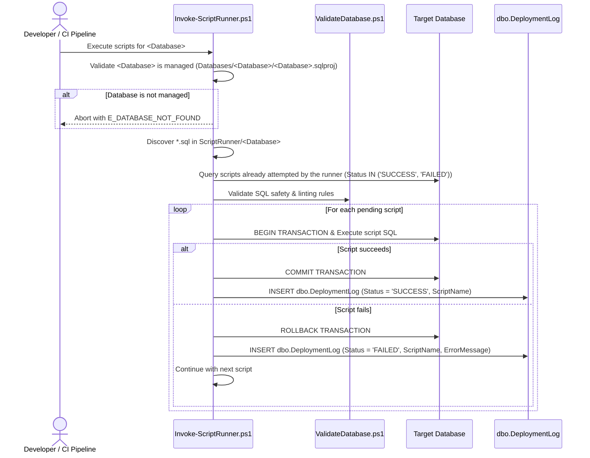

# SPEC-004: Per-Database Script Runner & Deployment Audit Logger

## Metadata

| Field | Value |
|---|---|
| ID | SPEC-004 |
| Title | Per-Database Script Runner & Deployment Audit Logger |
| Status | Approved |
| Version | 2.0.0 |
| Author | Antigravity |
| Owner | Maintainer |
| Dependencies | SPEC-001, SPEC-002, SPEC-003 |
| Created | 2026-10-10 |
| Last Updated | 2026-10-17 |

---

## 1. Problem Statement & Motivation

### 1.1 Problem
While declarative SSDT DACPAC models (`Databases/<Database>`) reliably maintain declarative database schemas (tables, views, functions, stored procedures), certain production operations require sequential, procedural, or one-off data manipulation and patch scripts (e.g. static configuration data migration, backfilling newly added non-nullable columns, one-off patching routines). Executing these scripts manually via SSMS creates serious hazards: script executions are not audited, accidental cross-database execution (such as running one database's script against another database or `master`) can cause data corruption, scripts might accidentally be executed multiple times without idempotency guardrails, and failures are not captured in centralized audit logs. A dedicated script folder per database, `ScriptRunner/<Database>`, and an automated runner engine are required to execute SQL scripts strictly against `<Database>` and automatically persist detailed audit logs to `[dbo].[DeploymentLog]`.

### 1.2 Goals
- G1: Establish a dedicated directory `ScriptRunner/<Database>` per managed database for housing sequential SQL scripts designed for execution against that database.
- G2: Enforce strict database isolation: scripts placed in `ScriptRunner/<Database>` must ONLY be permitted to execute against `<Database>`, and `-Database` must name a managed database (`Databases/<Database>/<Database>.sqlproj`).
- G3: Provide an automated PowerShell runner (`Scripts/Invoke-ScriptRunner.ps1`) that discovers, validates, and executes `.sql` scripts in natural alphanumeric order against the target database.
- G4: Support idempotent execution tracking by inspecting the runner's own `[dbo].[DeploymentLog]` rows for previous `SUCCESS` or `FAILED` executions of each `ScriptName`, ensuring each script is attempted only once unless explicitly overridden with `-Force`. A failed script is fixed forward by adding a new script file.
- G5: Record every script that is executed or rejected (`SUCCESS` or `FAILED`) into `[dbo].[DeploymentLog]` in the target database, capturing script name, UTC execution timestamps, duration, Git metadata (commit SHA, branch, author), pipeline metadata, and failure details.
- G6: Execute each script within an isolated transaction boundary, rolling back on error and logging the failure details in `[dbo].[DeploymentLog]`, without preventing subsequent scripts from running.
- G7: Enforce SQL safety validation on all scripts in `ScriptRunner/<Database>`, logging validation failures (e.g. `USE <db>` naming any database other than `<Database>`, or credentials) as `FAILED` in `[dbo].[DeploymentLog]`.
- G8: Keep `[dbo].[DeploymentLog]` limited to scripts that actually ran or failed: already-applied scripts are skipped without writing a log row, so adding a new script logs only that script.
- G9: On `main`, before `deploy_dev`, check the scripts that have not run yet (`-CheckOnly`) with the SQL Safety Validator (SPEC-003): risky statements wait for a person's approval (SPEC-002 CHK-14); `USE` of another database, credentials or a syntax error fail the pipeline. Scripts that already ran are not checked again.
- G10: `-Database All` runs every managed database in turn. With `-CheckOnly`, each database writes its own `artifacts/approval-required-<Database>.txt`; when any database fails without a list (a failure no one can approve), every list is removed so the pipeline offers no approval.

### 1.3 Non-Goals
- NG1: Allowing `ScriptRunner/<Database>` scripts to execute against any other database.
- NG2: Replacing declarative DACPAC schema definitions for normal table and view authoring.
- NG3: Supporting interactive manual prompts during automated CI/CD script execution runs.

### 1.4 Open Questions
| # | Question | Owner | Resolution |
|---|---|---|---|
| Q1 | Should `ScriptRunner/<Database>` scripts execute automatically during CI/CD `deploy_dev` after DACPAC publish, or via on-demand manual trigger? | Maintainer | Both CLI script (`Scripts/Invoke-ScriptRunner.ps1`) and automated step in `.gitlab-ci.yml` `deploy_dev` stage for every managed database. (Resolved 2026-10-10) |
| Q2 | Should the runner wrap each individual script file in a transaction by default (`COMMIT`/`ROLLBACK`), or require the script to manage its own transactions? | Maintainer | Wrap each script in an explicit transaction by default with automatic ROLLBACK on failure, unless script contains transaction-incompatible statements or `-NoTransaction` is set. (Resolved 2026-10-10) |
| Q3 | When a script fails in a batch, should subsequent scripts in the queue halt immediately? | Maintainer | Each script file is executed in its own isolated transaction boundary and logged individually. If one script fails (validation or execution error), that script's transaction rolls back, a FAILED record is inserted into `dbo.DeploymentLog`, and the runner proceeds to execute subsequent scripts in the batch. (Resolved 2026-10-11) |
| Q4 | How should previously executed scripts be handled? | Maintainer | Idempotent migration runner: inspects `dbo.DeploymentLog` for previous `SUCCESS` runs of each `ScriptName` and skips already-applied scripts unless `-Force` is specified. (Resolved 2026-10-10) Failed scripts are also never retried automatically; the fix is shipped as a new script file. (Amended 2026-10-11) |

### 1.5 Assumptions
- A1: The target SQL Server instance contains or dynamically provisions `[dbo].[DeploymentLog]` table matching SPEC-001/SPEC-002 schema definition.
- A2: Connection credentials for `<Database>` come from `-ConnectionString`, the CI variable `DEV_CONNECTION_STRING_<DATABASE>` (may be Base64-encoded), or, for local runs only, the git-ignored `appsettings.local.json`. Connection strings are never committed.
- A3: Scripts in `ScriptRunner/<Database>` are named with sortable prefixes (e.g. `001_seed_config.sql`, `002_backfill_customer.sql`) to guarantee deterministic execution order.

---

## 2. Architectural Boundaries & Data Flow

### 2.1 Module Placement
| Layer | Path(s) owned by this spec | Responsibility |
|---|---|---|
| domain | `ScriptRunner/<Database>/` | SQL script files intended exclusively for `<Database>` execution |
| core | `Scripts/Invoke-ScriptRunner.ps1` | Discovery, ordering, isolation checks, execution engine, and transaction handling |
| data | `Databases/<Database>/Tables/dbo.DeploymentLog.sql` | Target audit table recording all script execution history and metadata |
| interfaces | `.gitlab-ci.yml`, `Tests/ScriptRunnerTests.ps1` | Pipeline execution entrypoints, automated verification tests |

### 2.2 Data Flow


### 2.3 External Dependencies
| Dependency | Purpose | Failure mode | Timeout |
|---|---|---|---|
| Microsoft.Data.SqlClient / System.Data.SqlClient | ADO.NET connection and query execution | Database offline / connection timeout | 30s |
| Git CLI | Extract commit SHA, author, branch, and commit message | Git command unavailable / returns 'local' | 5s |

### 2.4 Decisions
| # | Decision | Alternatives considered | Rationale |
|---|---|---|---|
| D1 | Store scripts in a dedicated directory per database, `ScriptRunner/<Database>` | SSDT `PostDeployment.sql`, database migrations table | Gives clear visibility, prevents bloating DACPAC post-deployment scripts, and isolates target database explicitly by folder hierarchy. |
| D2 | Scripts in `ScriptRunner/<Database>` run only against `<Database>`, which must be a managed database whose connection string names it | One shared script folder for all databases | Prevents accidental execution of one database's scripts against another database or tenant. |
| D3 | Track executed scripts in `[dbo].[DeploymentLog]` | Separate `__MigrationHistory` table | Reuses the existing approved enterprise deployment audit table (`dbo.DeploymentLog`), ensuring a unified audit log. |

---

## 3. Data Schemas & API Contracts

### 3.1 Entities & Value Objects
```ts
interface ScriptRunnerOptions {
  database: string          // a managed database (Databases/<Database>/<Database>.sqlproj) or "All"
  targetEnvironment: "Development" | "Staging" | "Production"
  connectionString?: string
  scriptsDirectory?: string
  dryRun?: boolean          // validate and list scripts only; never connects to the database
  forceReapply?: boolean
  checkOnly?: boolean       // read dbo.DeploymentLog and check the scripts that have not run; never executes them
}

interface ScriptExecutionRecord {
  deploymentId?: number
  databaseName: string      // the target database
  targetEnvironment: string
  status: "SUCCESS" | "FAILED"
  scriptName: string
  deployedAtUtc: string
  completedAtUtc: string
  durationSeconds: number
  commitSha: string
  commitShortSha: string
  commitBranch: string
  commitTitle?: string
  commitAuthor?: string
  pipelineId?: string
  pipelineUrl?: string
  jobId?: string
  triggeredBy?: string
  errorMessage?: string
}
```

### 3.2 Operations / CLI Contracts
| Operation | Input | Output | Errors (§4.2 codes) | Auth | Idempotent |
|---|---|---|---|---|---|
| `Invoke-ScriptRunner.ps1` | `-Database <Database>\|All`, `-TargetEnvironment`, `[-ConnectionString]`, `[-DryRun]`, `[-CheckOnly]`, `[-Force]` | Execution report summary & `dbo.DeploymentLog` entries | `E_DATABASE_NOT_FOUND`, `E_DATABASE_MISMATCH`, `E_CONNECTION_FAILED`, `E_SCRIPT_FAILED`, `E_VALIDATION_FAILED` | CI / DB Admin | yes |

---

## 4. Error Modes, Invariants & Edge Cases

### 4.1 Invariants
| ID | Invariant |
|---|---|
| INV-01 | `ScriptRunner/<Database>` scripts MUST NEVER be executed against any database other than `<Database>`. |
| INV-02 | Every script in `ScriptRunner/<Database>` that the runner executes or rejects MUST record an entry in `[dbo].[DeploymentLog]` with `DatabaseName = '<Database>'`, `ScriptName = <filename>`, and Status (`SUCCESS` or `FAILED`). |
| INV-03 | By default, a script that previously logged `Status = 'SUCCESS'` or `Status = 'FAILED'` MUST NOT be re-executed unless `-Force` is provided. Only rows written by the runner (`DeployReportSummary = 'Executed via ScriptRunner for <Database>'`) count; rows written by `DeployDatabase.ps1` for the same file name are ignored. |
| INV-04 | `USE <Database>` / `USE [<Database>]` is allowed. Any script containing a `USE <db>` statement naming any other database, or connection credentials, fails validation, logs `Status = 'FAILED'` with the error details in `[dbo].[DeploymentLog]`, and does not halt subsequent scripts in the batch. |
| INV-05 | A script skipped due to a previous `SUCCESS` or `FAILED` run MUST NOT write a row to `[dbo].[DeploymentLog]`; it is reported on the console only. |
| INV-06 | Batch non-halting execution: When a script in a batch fails (validation or runtime SQL error), its failure is isolated and recorded, and remaining scripts continue to execute. The runner exits with non-zero exit code if any script failed in the batch. |
| INV-07 | On `main`, `deploy_dev` runs `ScriptRunner/` scripts only after `-CheckOnly` found no risky statement in the scripts that have not run; otherwise they run only when a person runs `deploy_dev_approved` (SPEC-002 CHK-06, CHK-14). |
| INV-08 | `-DryRun` validates and lists scripts without connecting to the database, so it can never write `[dbo].[DeploymentLog]` rows. |
| INV-09 | `-CheckOnly` connects only to read `dbo.DeploymentLog` (creating the table if missing, as in EC-02); it never executes scripts or writes log rows. It exits 1 with no approval list when the database is unreachable or a script that has not run uses another database, contains credentials or fails to parse; it exits 1 with `artifacts/approval-required-<Database>.txt` when such a script has risky statements (SPEC-003 §3.4); otherwise it exits 0. A list left from an earlier check is removed first. |
| INV-10 | `-Database All` runs every managed database, even after one fails, and exits 1 if any failed. It takes no `-ConnectionString` or `-ScriptsDirectory`. With `-CheckOnly`, when any database failed without an approval list, every `artifacts/approval-required-*.txt` is removed. |

### 4.2 Error Modes
| Code | Trigger | Caller receives | Retryable | Side effects / state after |
|---|---|---|---|---|
| `E_DATABASE_NOT_FOUND` | `-Database` names no `Databases/<Database>/<Database>.sqlproj` | Error and termination | no | No queries executed |
| `E_DATABASE_MISMATCH` | The connection string's `Initial Catalog` names a database other than `<Database>` | Error and termination | no | No queries executed |
| `E_CONNECTION_FAILED` | Target database connection cannot be established | Error with connection failure details | yes | No scripts executed |
| `E_VALIDATION_FAILED` | Script contains `USE` of a database other than `<Database>`, or credentials | Validation failure message and logged `FAILED` status | no | `FAILED` row logged to `dbo.DeploymentLog`; subsequent scripts continue; script is not retried on later runs |
| `E_SCRIPT_FAILED` | SQL syntax or runtime execution error in script | Script error message and failed status | no | Transaction rolled back; `FAILED` row logged to `dbo.DeploymentLog`; subsequent scripts continue; script is not retried on later runs |

### 4.3 Edge Cases
| ID | Scenario | Expected behavior |
|---|---|---|
| EC-01 | `ScriptRunner/<Database>` folder is missing, empty or contains no `.sql` files | Runner logs informational message and exits with status code 0. |
| EC-02 | Target table `[dbo].[DeploymentLog]` does not exist on target database | Runner verifies and creates table using standard schema before executing scripts. |
| EC-03 | A script fails midway through multiple statements | Script transaction is rolled back; `Status = 'FAILED'` is logged; execution of subsequent scripts in the batch continues. |
| EC-04 | All scripts in folder have already been executed successfully | Runner reports 0 pending scripts and exits cleanly with 0 changes applied. |

---

## 5. Verification Matrix

| AC ID | Criterion (Given / When / Then) | Covers | Test Reference | Status |
|---|---|---|---|---|
| AC-01 | **Given** the project root **When** developer inspects it **Then** `ScriptRunner/` is present and the runner reads `ScriptRunner/<Database>` by default | G1 | Tests/ScriptRunnerTests.ps1 | Verified |
| AC-02 | **Given** runner invoked with a database that is not managed **When** it starts **Then** execution terminates with `E_DATABASE_NOT_FOUND` | G2, INV-01 | Tests/ScriptRunnerTests.ps1 | Verified |
| AC-03 | **Given** unapplied `.sql` scripts in `ScriptRunner/<Database>` **When** runner executes **Then** scripts execute in alphanumeric order against `<Database>` | G3 | Tests/ScriptRunnerTests.ps1 | Verified |
| AC-04 | **Given** a script already executed with `Status = 'SUCCESS'` **When** runner runs without `-Force` **Then** script is skipped | G4, INV-03, EC-04 | Tests/ScriptRunnerTests.ps1 | Verified |
| AC-05 | **Given** a script runs successfully **When** execution completes **Then** `dbo.DeploymentLog` contains row with `Status = 'SUCCESS'` and `ScriptName` | G5, INV-02 | Tests/ScriptRunnerTests.ps1 | Verified |
| AC-06 | **Given** a script encounters a SQL error **When** execution fails **Then** transaction rolls back, row logged with `Status = 'FAILED'`, and subsequent scripts continue | G6, EC-03, E_SCRIPT_FAILED | Tests/ScriptRunnerTests.ps1 | Verified |
| AC-07 | **Given** a script containing `USE` of a database other than the target (e.g. `USE master`) **When** runner validates **Then** script is rejected with `E_VALIDATION_FAILED`, logged as `FAILED`, and subsequent scripts continue | G7, INV-04, E_VALIDATION_FAILED | Tests/ScriptRunnerTests.ps1 | Verified |
| AC-08 | **Given** `ScriptRunner/<Database>` has no `.sql` files **When** runner executes **Then** runner completes with 0 errors | EC-01 | Tests/ScriptRunnerTests.ps1 | Verified |
| AC-09 | **Given** target database lacks `dbo.DeploymentLog` **When** runner starts **Then** table is created before logging | EC-02 | Tests/ScriptRunnerTests.ps1 | Verified |
| AC-10 | **Given** a script executed with `-Force` flag **When** script was previously run **Then** script is re-executed and logged | G4 | Tests/ScriptRunnerTests.ps1 | Verified |
| AC-11 | **Given** a script already executed with `Status = 'SUCCESS'` **When** runner runs without `-Force` **Then** script is skipped and no row is written to `dbo.DeploymentLog` | G8, INV-05 | Tests/ScriptRunnerTests.ps1 | Verified |
| AC-12 | **Given** a batch containing failing and passing scripts **When** runner executes **Then** all scripts are processed, each script is logged separately, and valid scripts execute successfully | G5, G6, INV-06 | Tests/ScriptRunnerTests.ps1 | Verified |
| AC-13 | **Given** a script containing `USE <Database>;` or `USE [<Database>];` **When** runner validates **Then** script passes validation and is executed | G7, INV-04 | Tests/ScriptRunnerTests.ps1 | Verified |
| AC-14 | **Given** a script whose last runner row in `dbo.DeploymentLog` is `Status = 'FAILED'` **When** runner runs without `-Force` **Then** script is skipped, not re-executed, and not logged again; rows not written by the runner are ignored | G4, INV-03, INV-05 | Tests/ScriptRunnerTests.ps1 | Verified |
| AC-15 | **Given** `.gitlab-ci.yml` and `Invoke-ScriptRunner.ps1` **When** inspected **Then** `validate_sql` does not scan `ScriptRunner/`, `check_scripts` runs `-CheckOnly`, and `-CheckOnly`, before any script executes, rejects `USE`/credentials and passes only scripts without a runner row in `dbo.DeploymentLog` to `Test-SqlSafety.ps1 -ApprovalListPath` | G9, INV-07, INV-09 | Tests/ScriptRunnerTests.ps1 | Verified |
| AC-16 | **Given** `-DryRun` and a connection string **When** the runner executes **Then** it lists the scripts and exits 0 without connecting to the database | INV-08 | Tests/ScriptRunnerTests.ps1 | Verified |
| AC-17 | **Given** an unreachable database **When** the runner runs with `-CheckOnly` **Then** it exits 1 and writes no approval list | INV-09 | Tests/ScriptRunnerTests.ps1 | Verified |
| AC-18 | **Given** approval lists left from earlier checks and a database that fails `-CheckOnly` without a list **When** the runner runs `-Database All -CheckOnly` **Then** it exits 1 and no approval list remains; `-Database All` with `-ConnectionString` is rejected | G10, INV-09, INV-10 | Tests/ScriptRunnerTests.ps1 | Verified |
