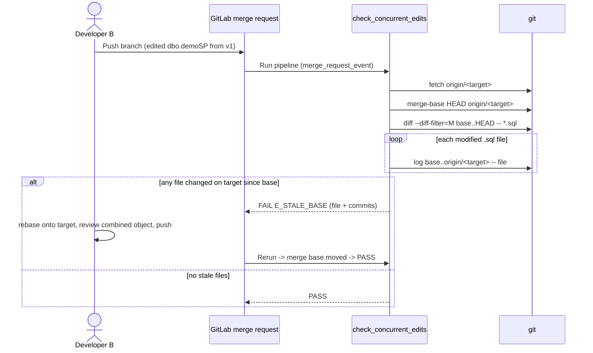

# SPEC-005: Concurrent Edit Guard for SQL Objects

## Metadata

| Field | Value |
|---|---|
| ID | SPEC-005 |
| Title | Concurrent Edit Guard for SQL Objects |
| Status | Approved |
| Version | 0.1.1 |
| Author | Claude |
| Owner | Maintainer |
| Dependencies | SPEC-001, SPEC-002 |
| Created | 2026-10-11 |
| Last Updated | 2026-10-17 |

---

## 1. Problem Statement & Motivation

### 1.1 Problem
Two developers can start from the same version of a SQL object (e.g. `dbo.demoSP`, v1) and edit different sections of it. When the second developer pulls the first developer's change, Git merges the two edits automatically because they don't touch the same lines. The combined object is then built and deployed without anyone reviewing it as a whole. Git's line-based conflict detection can't see semantic conflicts: a renamed variable, a changed result column, or a business rule that the other section depended on. Today every commit goes directly to `main` (0 merge requests), so no check runs before the combined object lands.

### 1.2 Goals
- G1: A merge request that modifies a `.sql` file fails its pipeline when that file changed on the target branch after the merge request's branch was created ("working version ≠ current version"). The developer is told which file and which commits.
- G2: After the developer rebases onto (or merges) the target branch, the same check passes, so the combined object has been in front of the developer and the merge request reviewer, and has passed the DACPAC build.
- G3: Git history is the only version source. Developers do not maintain version headers, manifests, or a version table.
- G4: `deploy_dev` never runs two deployments against the same database at once.

### 1.3 Non-Goals
- NG1: Proving that the combined object is semantically correct. Review, the DACPAC build (SPEC-001) and SQL safety checks (SPEC-003) remain responsible for that.
- NG2: Blocking direct pushes to `main` in code. That is a GitLab project setting (A1).
- NG3: A version registry table, per-object manifest, or canonical SQL hashing.
- NG4: Blocking deployment on database drift (`Scripts/DetectDrift.ps1` already reports drift).
- NG5: Following file renames.

### 1.4 Open Questions
| # | Question | Owner | Resolution |
|---|---|---|---|
| Q1 | Which files are checked? | Maintainer | Every `*.sql` file in the repository (DACPAC objects under `Databases/` and scripts under `ScriptRunner/`). (Resolved 2026-10-11) |
| Q2 | Use a version header / manifest / registry, or Git history? | Maintainer | Git history (merge base vs. target branch). (Resolved 2026-10-11) |

### 1.5 Assumptions
- A1: `main` is protected with "Allowed to push: No one", merges go through merge requests, "Pipelines must succeed" is on, and the merge method is "Merge commit with semi-linear history". If false: the check never runs before code lands on `main` (no merge request), or a merge request whose pipeline passed earlier can still merge after `main` moved.
- A2: The CI job can fetch the target branch from `origin` and has full history (`GIT_DEPTH: 0`). If false: the merge base can't be computed and the job fails with `E_GIT_FAILED`.

---

## 2. Architectural Boundaries & Data Flow

### 2.1 Module Placement
| Layer | Path(s) owned by this spec | Responsibility |
|---|---|---|
| core | `Scripts/Test-ConcurrentEdits.ps1` | Compute merge base, find stale `.sql` files, report and set exit code |
| interfaces | `.gitlab-ci.yml` (`check_concurrent_edits` job, `deploy_dev.resource_group`), `Tests/ConcurrentEditTests.ps1` | Pipeline entrypoint, deploy serialization, verification |
| docs | `docs/Development.md` | Developer workflow for fixing `E_STALE_BASE` |

### 2.2 Data Flow


### 2.3 External Dependencies
| Dependency | Purpose | Failure mode | Timeout |
|---|---|---|---|
| Git CLI | merge-base, diff, log, fetch | Command fails → `E_GIT_FAILED`, job fails | job timeout |
| GitLab `resource_group` | Serialize `deploy_dev` | Jobs wait in queue | job timeout |

### 2.4 Decisions
| # | Decision | Alternatives considered | Rationale |
|---|---|---|---|
| D1 | The merge base is the "working version"; commits on the target branch after it that touch the file mean "current version differs" | Version header in file; JSON manifest; `DatabaseObjectVersion` table with SHA-256 hashes | Git already records both versions and content hashes. A header changed to the same value by two developers merges silently; manifests and tables duplicate Git and can drift from it. |
| D2 | Check only modified files (`--diff-filter=M`) | Check added/deleted/renamed too | A new file has no earlier version to be stale against. Deletes and renames are visible in review. |
| D3 | Run only in merge request pipelines | Also on `main` pushes | On `main` there is no target to compare against, and the code has already landed. |
| D4 | Serialize deploys with GitLab `resource_group` | `sp_getapplock` in deploy scripts | Native, one line, no database changes. |

---

## 3. Data Schemas & API Contracts

### 3.1 Entities & Value Objects
```ts
interface StaleFile {
  path: string                // repo-relative path, e.g. 'Databases/SampleDb/StoredProcedures/dbo.usp_GetDeploymentHistory.sql'
  targetCommits: string[]     // '<shortSha> <author>: <subject>', newest first
}
```

### 3.2 Operations / CLI Contracts
| Operation | Input | Output | Errors (§4.2 codes) | Auth | Idempotent |
|---|---|---|---|---|---|
| `Test-ConcurrentEdits.ps1` | `[-TargetBranch <name>]` (default `$env:CI_MERGE_REQUEST_TARGET_BRANCH_NAME`), `[-RepoPath <dir>]` (default project root) | Console report; exit 0 = no stale files or not a merge request pipeline; exit 1 = stale files or Git failure | `E_STALE_BASE`, `E_GIT_FAILED` | CI job token (read) | yes |

### 3.3 Persistence
none

### 3.4 Compatibility & Migration
Adds one CI job and one `resource_group` key. No change to existing jobs' behavior on `main`. Developers must switch from pushing to `main` to merge requests (A1).

---

## 4. Error Modes, Invariants & Edge Cases

### 4.1 Invariants
| ID | Invariant |
|---|---|
| INV-01 | A merge request pipeline fails if any `.sql` file modified on the branch was also changed on the target branch after the merge base. |
| INV-02 | Files changed only on the branch, or only on the target, never fail the check. |
| INV-03 | Outside a merge request pipeline (no target branch), the check exits 0 without inspecting files. |
| INV-04 | At most one `deploy_dev` job runs at a time. |

### 4.2 Error Modes
| Code | Trigger | Caller receives | Retryable | Side effects / state after |
|---|---|---|---|---|
| `E_STALE_BASE` | A modified `.sql` file has commits on the target branch after the merge base | `ERROR [<path>]: changed on <target> after you branched` with the commits, the fix instructions, exit 1 | after rebase | none |
| `E_GIT_FAILED` | `git fetch` or `git merge-base` fails (e.g. shallow clone, missing target) | Error message, exit 1 | yes | none |

### 4.3 Edge Cases
| ID | Scenario | Expected behavior |
|---|---|---|
| EC-01 | Both developers edit different sections of the same file; A merges first | B's merge request fails with `E_STALE_BASE` naming A's commit. |
| EC-02 | B rebases onto the target (or merges the target in) | Merge base moves; B's merge request passes. |
| EC-03 | A and B edit different `.sql` files | Both pass. |
| EC-04 | B adds a brand-new `.sql` file | Passes. |
| EC-05 | Branch changes no `.sql` files | Passes. |
| EC-06 | Pipeline is a `main` push or schedule | Exits 0 with an info message. |
| EC-07 | File path contains spaces (e.g. `dbo.usp_Report copy.sql`) | Handled correctly. |

### 4.4 Security & Privacy
- Authn/Authz: read-only Git operations with the CI job token; no database access.
- Data classification: logs contain file paths, short SHAs, author names and commit subjects only.
- Abuse cases: a developer cannot bypass the check by editing a file; only rebasing onto the target moves the merge base.

### 4.5 Non-Functional Requirements
- The check completes in under 30 seconds for this repository.

---

## 5. Verification Matrix

| AC ID | Criterion (Given / When / Then) | Covers | Test Reference | Status |
|---|---|---|---|---|
| AC-01 | **Given** a branch from v1 that edits section B of `dbo.demoSP.sql` and a target branch where section A was edited after v1 **When** the check runs **Then** it exits 1 with `E_STALE_BASE`, the file path and the target commit | G1, INV-01, E_STALE_BASE, EC-01, EC-07 | Tests/ConcurrentEditTests.ps1 | Verified |
| AC-02 | **Given** the target branch changed a different `.sql` file than the branch **When** the check runs **Then** it exits 0 | INV-02, EC-03 | Tests/ConcurrentEditTests.ps1 | Verified |
| AC-03 | **Given** the AC-01 branch rebased onto the target **When** the check runs **Then** it exits 0 | G2, EC-02 | Tests/ConcurrentEditTests.ps1 | Verified |
| AC-04 | **Given** a branch that only adds a new `.sql` file, or changes no `.sql` file **When** the check runs **Then** it exits 0 | EC-04, EC-05 | Tests/ConcurrentEditTests.ps1 | Verified |
| AC-05 | **Given** no target branch (not a merge request pipeline) **When** the check runs **Then** it exits 0 with an info message | INV-03, EC-06 | Tests/ConcurrentEditTests.ps1 | Verified |
| AC-06 | **Given** `.gitlab-ci.yml` **When** inspected **Then** `check_concurrent_edits` runs `Scripts/Test-ConcurrentEdits.ps1` in the `validate` stage, only for `merge_request_event`, with `GIT_DEPTH: "0"` | G1, A2 | Tests/ConcurrentEditTests.ps1 | Verified |
| AC-07 | **Given** `.gitlab-ci.yml` **When** inspected **Then** `deploy_dev` has `resource_group: deploy-dev` | G4, INV-04 | Tests/ConcurrentEditTests.ps1 | Verified |
| AC-08 | **Given** a repository where the target branch cannot be fetched **When** the check runs **Then** it exits 1 with `E_GIT_FAILED` | E_GIT_FAILED | Tests/ConcurrentEditTests.ps1 | Verified |
